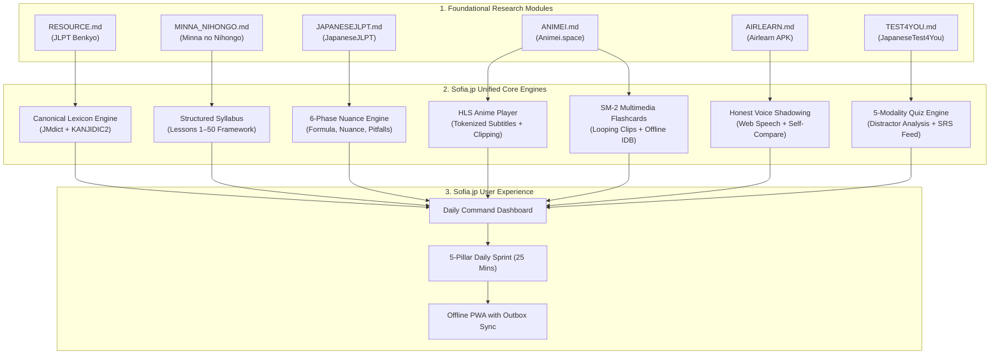
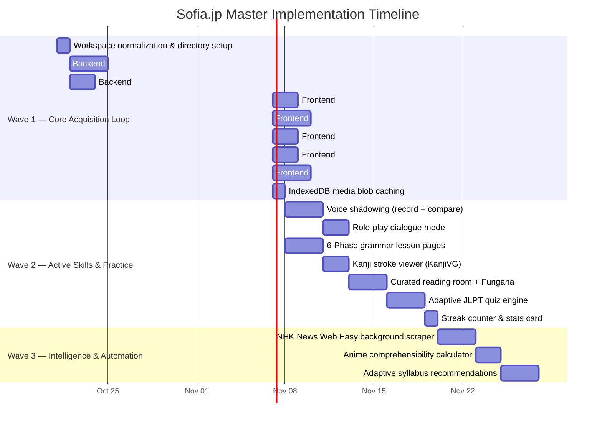

# Sofia.jp — Master Project Architecture & Comprehensive Resource Specification
**Document Identifier:** `D:\sofia.jp\MASTER_PROJECT_RESOURCES.md`  
**Version:** 1.0 (Master Consolidated Architecture)  
**Date:** October 21, 2026  
**Scope:** Complete synthesis of all six reverse-engineered research modules (`RESOURCE.md`, `MINNA_NIHONGO_RESOURCE.md`, `JAPANESETEST4YOU_RESOURCE.md`, `JAPANESEJLPT_RESOURCE.md`, `AIRLEARN_VOICE_RESOURCE.md`, `ANIMEI_LEARNING_RESOURCE.md`) unified with the master engineering design from [`PROJECT_SPEC.md`](file:///D:/sofia.jp/PROJECT_SPEC.md).

---

## Table of Contents
1. [Executive Summary & Architectural Synthesis](#1-executive-summary--architectural-synthesis)
2. [Master Workspace & Repository Architecture](#2-master-workspace--repository-architecture)
3. [Deep-Dive Module 1: JLPT Benkyo Lexicon & Kanji Engine (`RESOURCE.md`)](#3-deep-dive-module-1-jlpt-benkyo-lexicon--kanji-engine)
4. [Deep-Dive Module 2: Minna no Nihongo Syllabus & Lesson Feed (`MINNA_NIHONGO_RESOURCE.md`)](#4-deep-dive-module-2-minna-no-nihongo-syllabus--lesson-feed)
5. [Deep-Dive Module 3: JapaneseJLPT 6-Phase Grammar Engine (`JAPANESEJLPT_RESOURCE.md`)](#5-deep-dive-module-3-japanesejlpt-6-phase-grammar-engine)
6. [Deep-Dive Module 4: Animei Video Streaming, Subtitles & SRS (`ANIMEI_LEARNING_RESOURCE.md`)](#6-deep-dive-module-4-animei-video-streaming-subtitles--srs)
7. [Deep-Dive Module 5: Airlearn Voice Assessment & Dialogue Shadowing (`AIRLEARN_VOICE_RESOURCE.md`)](#7-deep-dive-module-5-airlearn-voice-assessment--dialogue-shadowing)
8. [Deep-Dive Module 6: JapaneseTest4You JLPT Examination Engine (`JAPANESETEST4YOU_RESOURCE.md`)](#8-deep-dive-module-6-japanesetest4you-jlpt-examination-engine)
9. [The 5 Core Pillars: Integrated User Experience](#9-the-5-core-pillars-integrated-user-experience)
10. [Master Relational Database Architecture (SQLite DDL)](#10-master-relational-database-architecture-sqlite-ddl)
11. [Master API Gateway Specification (FastAPI)](#11-master-api-gateway-specification-fastapi)
12. [Frontend Architecture & Component Hierarchy (React 18 + Vite)](#12-frontend-architecture--component-hierarchy-react-18--vite)
13. [Curriculum Inventory & Content Volume (N5 to N1)](#13-curriculum-inventory--content-volume-n5-to-n1)
14. [The 3-Wave Execution Roadmap & Verification Plan](#14-the-3-wave-execution-roadmap--verification-plan)

---

## 1. Executive Summary & Architectural Synthesis

Project **Sofia.jp** is an all-in-one Japanese language acquisition platform (covering JLPT N5 through N1) designed for private personal deployment. It eliminates the traditional fragmentation of Japanese study tools by combining six specialized pedagogical and technical engines into a single closed-loop ecosystem:



### The 10 Inviolable Architectural Decisions
1. **3-Wave Staged Rollout:** Wave 1 delivers a working anime player + vocabulary/sentence saving + looping clip flashcards within 2 weeks. Wave 2 adds voice shadowing, role-play dialogues, grammar pages, reading room, and quizzes. Wave 3 adds intelligence and automation.
2. **Direct Animei Proxying:** Zero anime video files or transcoded episodes are hosted on Sofia.jp's server. Sofia.jp proxies Animei's production endpoints for catalog metadata, multi-quality HLS streams (`.m3u8`), tokenized subtitles, and server-side micro-clips.
3. **Canonical Identity (JMdict & Unicode):** Every word references its 7-digit `jmdict_id`; every Kanji references its Unicode codepoint (`U+XXXX`). All anime tokens, grammar lesson words, and test items link to the same canonical database records.
4. **Honest Voice Assessment:** No fabricated "94% pitch accuracy" algorithms. Uses browser Web Speech API for transcript matching (green = matched, red = missed) and provides side-by-side audio playback comparison (`[Play Native]` vs. `[Play Your Recording]`).
5. **First-Class Sentence Mining:** Saved items allow saving both single words and complete dialogue sentences with audio prompts on the front and looping video clips on the back.
6. **Stroke Order Rendering (KanjiVG):** Uses open-source KanjiVG SVG data rendered with `dmak.js` for stroke animations, paired with a freeform canvas for visual self-checking (skipping complex handwriting grading).
7. **Curated Reading Library First:** 50+ pre-bundled public-domain stories (fairy tales, Aozora Bunko, Wikipedia Simple) with 4-mode Furigana toggles, deferring dynamic web scrapers to Wave 3.
8. **Independent Grammar Content:** Uses Minna no Nihongo's 1–50 ordering as a structural framework only; all explanations, example sentences, and dialogues are 100% original creations.
9. **3-Tier Grammar Explain Fallback:** Tier 1: Animei `explain` API $\rightarrow$ Tier 2: IndexedDB cache $\rightarrow$ Tier 3: Static pre-bundled JSON (`grammar_n5_n3.json`).
10. **Idempotent Outbox Synchronization:** Reviews and quiz results are stored locally in an immutable event log (`user_review_events`) and synced to SQLite without multi-device interval collisions.

---

## 2. Master Workspace & Repository Architecture

```
D:\sofia.jp\
├── docs/                                  # Research archives & documentation
│   ├── RESOURCE.md                        # JLPT Benkyo reverse-engineering
│   ├── MINNA_NIHONGO_RESOURCE.md          # Minna no Nihongo analysis
│   ├── JAPANESETEST4YOU_RESOURCE.md       # JapaneseTest4You analysis
│   ├── JAPANESEJLPT_RESOURCE.md           # JapaneseJLPT 6-phase analysis
│   ├── AIRLEARN_VOICE_RESOURCE.md         # Airlearn APK decompilation
│   ├── ANIMEI_LEARNING_RESOURCE.md        # Animei.space inspection
│   └── sources.txt                        # Upstream URL references
│
├── backend/                               # Python FastAPI backend service
│   ├── app/
│   │   ├── main.py                       # App initialization & CORS
│   │   ├── database.py                   # Async SQLite connection
│   │   ├── routers/
│   │   │   ├── anime.py                  # Animei streaming & catalog proxy
│   │   │   ├── vocabulary.py             # Saved words & sentence mining
│   │   │   ├── grammar.py                # 6-Phase grammar lesson serving
│   │   │   ├── reading.py                # Curated reading passages
│   │   │   ├── quiz.py                   # 5-Modality JLPT quiz engine
│   │   │   └── explain.py                # 3-Tier grammar breakdown fallback
│   │   ├── services/
│   │   │   ├── animei_client.py          # HTTP proxy to Animei backend
│   │   │   ├── tokenizer.py              # SudachiPy full morpheme parser
│   │   │   ├── srs_engine.py             # SM-2 interval calculator (2.2x)
│   │   │   └── tts.py                    # edge-tts neural voice generator
│   │   ├── models/                       # SQLModel ORM relational schemas
│   │   └── data/                         # Static datasets (JMdict, KANJIDIC2)
│   │       ├── jmdict_subset.json        # Core 10,000 JLPT vocabulary entries
│   │       ├── kanjidic2.json            # 2,136 Joyo Kanji metadata
│   │       ├── kanjivg/                  # SVG stroke order data
│   │       ├── grammar_n5_n3.json        # 200+ original grammar lessons
│   │       └── readings/                 # Curated public-domain texts
│   ├── requirements.txt
│   └── tests/
│
├── frontend/                              # React 18 + Vite + TypeScript PWA
│   ├── src/
│   │   ├── pages/
│   │   │   ├── DashboardPage.tsx         # Daily Command Center
│   │   │   ├── AnimeCatalogPage.tsx      # Anime library & search
│   │   │   ├── AnimePlayerPage.tsx       # Video player + tokenized subs
│   │   │   ├── SrsReviewPage.tsx         # Looping video clip flashcards
│   │   │   ├── GrammarLessonPage.tsx     # 6-Section structured grammar
│   │   │   ├── KanjiBrowserPage.tsx      # Kanji stroke animations & viewer
│   │   │   ├── ReadingRoomPage.tsx       # Dokkai passages + Furigana toggle
│   │   │   ├── QuizPage.tsx              # Adaptive practice exams
│   │   │   └── StatsPage.tsx             # Streaks & weekly summary card
│   │   ├── components/
│   │   │   ├── player/                   # VideoPlayer, SubtitleOverlay, Transcript
│   │   │   ├── voice/                    # VoiceShadowModal, WaveformVisualizer
│   │   │   ├── srs/                      # CardFront, CardBack, LoopingClipPlayer
│   │   │   └── common/                   # TokenSpan, Popover, Navbar, Sidebar
│   │   ├── stores/                       # Zustand state stores
│   │   ├── services/                     # api.ts, idb.ts (Dexie database)
│   │   └── types/                        # TypeScript domain interfaces
│   ├── package.json
│   ├── vite.config.ts
│   └── tailwind.config.ts
│
├── tools/                                 # Isolated reverse engineering tools
│   └── rea/                              # REA TypeScript monorepo
├── storage/                               # Runtime local SQLite data
│   └── sofia.db                          # Master relational database
├── MASTER_PROJECT_RESOURCES.md            # This master document
├── MASTER_PROMPT.md                       # Developer & AI master system prompt
├── AGENT.md                               # Agent operating manual
├── BUILD_GUIDE.md                         # End-to-end setup & run guide
├── IMPLEMENTATION_PLAN.md                 # Sprint-by-sprint roadmap
└── PROJECT_SPEC.md                        # Master product specification
```

---

## 3. Deep-Dive Module 1: JLPT Benkyo Lexicon & Kanji Engine (`RESOURCE.md`)

### 3.1 Provenance & Findings
Extracted from reverse-engineering the JLPT Benkyo platform. It provides the structured data schema for JLPT N5 through N1 vocabulary and Kanji, establishing the **Phonetic Triad**:
$$\text{Kanji (Logographic)} \longleftrightarrow \text{Kana (Phonetic)} \longleftrightarrow \text{Romaji / Meaning (Semantic)}$$

### 3.2 Key Data Attributes Integrated
- **Pitch Accent Representation:** Categorized into four standard Japanese pitch patterns: *Heiban* (Flat, pattern 0), *Atamadaka* (Head-high, pattern 1), *Nakadaka* (Middle-high), and *Odaka* (Tail-high).
- **Kanji Deconstruction:** Radicals, stroke counts, grade levels, Onyomi readings, Kunyomi readings, and high-frequency Jukugo (Kanji compound words).
- **Collocation Pairings:** Linking verbs with their natural noun-particle objects (e.g., `傘をさす`, `試験に受かる`).

### 3.3 Sofia.jp Architectural Upgrades
- **Canonical Standardization:** All isolated Benkyo IDs (`v_n5_001`) are migrated to universal **JMdict IDs** (`jmdict_id`), linking textbook words directly with anime dialogue tokens.
- **KanjiVG Stroke Integration:** Replaced static stroke order numbers with animated SVG stroke paths rendered via `dmak.js`.

---

## 4. Deep-Dive Module 2: Minna no Nihongo Syllabus & Lesson Feed (`MINNA_NIHONGO_RESOURCE.md`)

### 4.1 Provenance & Findings
Extracted from analyzing the gold-standard 50-lesson Minna no Nihongo curriculum. It provides the progression blueprint for Japanese sentence structure:
- **Book 1 (Lessons 1–25):** JLPT N5 foundation (polite copula, directional motion, Te-form, continuous actions, permissions, plain form).
- **Book 2 (Lessons 26–50):** JLPT N4 intermediate bridge (conditionals, intent, passive, causative, giving/receiving, humble/honorific Keigo).

### 4.2 The 4-Part Lesson Unit Architecture
1. **Bunkei (文型 - Sentence Patterns):** Core grammatical formulas.
2. **Reibun (例文 - Example Sentences):** Short, contextual conversational Q&A pairs.
3. **Kaiwa (会話 - Dialogues):** Situational dialogues in natural environments (station, hospital, shopping).
4. **Renshuu (練習 - Drills):** Mechanical substitution and conjugation exercises.

### 4.3 Sofia.jp Architectural Upgrades
- **Legal Compliance:** To eliminate copyright liability, Sofia.jp utilizes the **lesson numbering and grammatical sequencing only**. All dialogue scripts, explanations, and exercises are **100% original content**, and vocabulary is drawn from open JMdict data.
- **Anime Scene Pairing:** Every Minna no Nihongo lesson is paired with 3–5 native anime scenes that demonstrate the target grammar in emotional context.

---

## 5. Deep-Dive Module 3: JapaneseJLPT 6-Phase Grammar Engine (`JAPANESEJLPT_RESOURCE.md`)

### 5.1 Provenance & Findings
Extracted from JapaneseJLPT's grammatical breakdown methodology. It prevents learner confusion by enforcing a strict 6-phase pedagogical dissection for every grammar rule:

```
┌────────────────────────────────────────────────────────┐
│             THE 6-PHASE GRAMMAR ENGINE                 │
├─────────┬──────────────────────────────────────────────┤
│ Phase 1 │ Structure & Conjugation Formula              │
│         │ Exact attachment rules (e.g., Verb-て + ください)│
├─────────┼──────────────────────────────────────────────┤
│ Phase 2 │ Core Meaning & Nuance                        │
│         │ Formality level, speaker attitude, register   │
├─────────┼──────────────────────────────────────────────┤
│ Phase 3 │ Contextual Sentence Proofs                   │
│         │ Native sentences proven through media         │
├─────────┼──────────────────────────────────────────────┤
│ Phase 4 │ Common Pitfalls & Traps                      │
│         │ Side-by-side contrast against similar rules  │
├─────────┼──────────────────────────────────────────────┤
│ Phase 5 │ Targeted Practice Drills                     │
│         │ Conjugation and particle fill-in-the-blanks  │
├─────────┼──────────────────────────────────────────────┤
│ Phase 6 │ Real-World Usage & Casual Forms              │
│         │ Colloquial contractions (〜ちゃう, 〜とく)   │
└─────────┴──────────────────────────────────────────────┘
```

### 5.2 Sofia.jp Architectural Upgrades
- Mapped Phase 3 directly to timestamped anime dialogue scenes from the Animei stream.
- Embedded Phase 4's pitfall comparison tables into `<GrammarLessonPage>` and quiz feedback dialogs.

---

## 6. Deep-Dive Module 4: Animei Video Streaming, Subtitles & SRS (`ANIMEI_LEARNING_RESOURCE.md`)

### 6.1 Provenance & Findings
Extracted from live static and network inspection of `https://animei.space/app/`:
- **Catalog API:** `GET /api/v1/catalog/popular` and `/catalog/search` returning Shikimori posters and episode counts.
- **HLS Video Streaming:** `GET /api/v1/catalog/stream?type=seria&id={epId}&hash={epHash}` returning multi-bitrate `.m3u8` streams from the Kodik CDN proxy.
- **Tokenized Subtitles:** `GET /api/v1/subtitles/episode?title={romaji}&episode={num}&shikimoriId={id}&translate=en` returning millisecond-accurate JSON subtitle segments with morpheme tokens (`surface`, `base`, `reading`, `pos`, `learnable`).
- **Micro-Clipping:** `POST /api/v1/words/clip` slicing 3–6 second MP4 clips for vocabulary cards.
- **Client Cache:** IndexedDB (`animei-media`) storing video blobs (`clips`), audio blobs (`audios`), and JSON explanations (`explains`).
- **SRS Algorithm:** Modified SM-2 formula ($2.2\times$ multiplier) with LocalStorage outbox queue.

### 6.2 Sofia.jp Architectural Upgrades
- **First-Class Sentence Mining:** Added a `[Save Full Sentence]` button alongside `[Save Word]`, capturing complete sentences with audio on the front and looping video on the back.
- **3-Tier Grammar Explain Fallback:** Created a fail-safe fallback chain (Animei Live API $\rightarrow$ IndexedDB Cache $\rightarrow$ Bundled Static JSON `grammar_n5_n3.json`) ensuring explanations work 100% offline.

---

## 7. Deep-Dive Module 5: Airlearn Voice Assessment & Dialogue Shadowing (`AIRLEARN_VOICE_RESOURCE.md`)

### 7.1 Provenance & Findings
Extracted from decompiling and analyzing speech-training APK architectures. Identifies character dialogue shadowing (repeating native dialogue immediately after audio playback) as the most effective method for developing natural cadence, rhythm, and pitch accent.

### 7.2 Sofia.jp Architectural Upgrades
- **Replaced Fake Pitch Scoring:** Eliminated computationally heavy, uncalibrated server-side pitch algorithms. Instead, implemented **browser Web Speech API transcript matching** with color-coded word feedback (Green = matched, Red = missed).
- **Self-Compare Audio Playback:** The browser records user audio via `MediaRecorder` and renders side-by-side controls: `[Play Native Audio]` vs. `[Play Your Recording]`, empowering learners to evaluate their own pronunciation.
- **Role-Play Dialogue Mode:** Uses subtitle timeline alternation to create an interactive conversational mode where the system plays Character A and the learner speaks Character B's lines in rhythm.

---

## 8. Deep-Dive Module 6: JapaneseTest4You JLPT Examination Engine (`JAPANESETEST4YOU_RESOURCE.md`)

### 8.1 Provenance & Findings
Extracted from the JapaneseTest4You examination database. Defines the five core question modalities required for JLPT readiness:
1. **Particle Cloze:** Selecting correct case, topic, or directional particles (`は`, `が`, `を`, `に`, `で`, `へ`, `から`, `まで`).
2. **Vocab Meaning:** Choosing the accurate contextual definition among plausible distractors.
3. **Listening Cloze:** Audio-prompted sentence with a missing target morpheme.
4. **Sentence Ordering (Star Puzzles):** Arranging scrambled interactive word tiles into grammatical sequence.
5. **Reading Comprehension (Dokkai):** Answering contextual intent questions after reading a passage.

### 8.2 Sofia.jp Architectural Upgrades
- **Closed-Loop Error Remediation:** When a user selects an incorrect option in a quiz, the system displays the specific *distractor reason* and automatically injects the failed vocabulary or grammar item into tomorrow's **SRS flashcard review queue**.

---

## 9. The 5 Core Pillars: Integrated User Experience

```
┌────────────────────────────────────────────────────────┐
│             DAILY SOFIA.JP 25-MINUTE SPRINT            │
├──────────┬─────────────────────────────────────────────┤
│ 00 – 05m │ 🧠 Daily SRS Review (Due Flashcards)        │
│          │ Words & sentences with looping anime clips. │
├──────────┼─────────────────────────────────────────────┤
│ 05 – 12m │ 📚 Structured Lesson (Grammar + Kanji)      │
│          │ Minna lesson formula + animated stroke pad. │
├──────────┼─────────────────────────────────────────────┤
│ 12 – 18m │ 🎬 Anime Immersion & Voice Shadowing        │
│          │ Watch scene with subtitles + mic shadowing. │
├──────────┼─────────────────────────────────────────────┤
│ 18 – 25m │ 📰 Reading Room (Dokkai) + JLPT Quiz        │
│          │ Read passage with Furigana + test quiz.     │
└──────────┴─────────────────────────────────────────────┘
```

---

## 10. Master Relational Database Architecture (SQLite DDL)

This unified schema anchors all vocabulary, anime tokens, grammar points, and quiz attempts to universal **JMdict IDs** and Unicode codepoints:

```sql
-- ========================================================
-- 1. CANONICAL LEXICON (From JMdict, KANJIDIC2 & KanjiVG)
-- ========================================================
CREATE TABLE IF NOT EXISTS dictionary_words (
    jmdict_id INTEGER PRIMARY KEY,        -- Universal JMdict entry ID
    word TEXT NOT NULL,                    -- Kanji representation (e.g., 食べる)
    reading TEXT NOT NULL,                 -- Hiragana reading (たべる)
    romaji TEXT,
    meanings_json TEXT NOT NULL,           -- JSON array: ["to eat", "to consume"]
    pos TEXT,                             -- Part of speech
    jlpt_level TEXT CHECK(jlpt_level IN ('N5','N4','N3','N2','N1')),
    pitch_accent TEXT,                    -- Heiban (0), Atamadaka (1), etc.
    common INTEGER DEFAULT 0
);
CREATE INDEX IF NOT EXISTS idx_words_word ON dictionary_words(word);
CREATE INDEX IF NOT EXISTS idx_words_jlpt ON dictionary_words(jlpt_level);

CREATE TABLE IF NOT EXISTS dictionary_kanji (
    kanji TEXT PRIMARY KEY,               -- Single Unicode character (e.g., 食)
    strokes INTEGER NOT NULL,
    grade INTEGER,
    jlpt_level TEXT CHECK(jlpt_level IN ('N5','N4','N3','N2','N1')),
    radical TEXT,
    radical_meaning TEXT,
    onyomi_json TEXT,                     -- JSON: ["ショク", "ジキ"]
    kunyomi_json TEXT,                    -- JSON: ["た.べる", "く.う"]
    meanings_json TEXT,                   -- JSON: ["eat", "food"]
    kanjivg_svg TEXT,                     -- KanjiVG SVG stroke order path data
    mnemonic TEXT
);

CREATE TABLE IF NOT EXISTS kanji_compounds (
    id INTEGER PRIMARY KEY AUTOINCREMENT,
    kanji TEXT NOT NULL REFERENCES dictionary_kanji(kanji) ON DELETE CASCADE,
    compound TEXT NOT NULL,
    reading TEXT NOT NULL,
    meaning TEXT NOT NULL,
    jlpt_level TEXT
);

-- ========================================================
-- 2. STRUCTURED GRAMMAR (Minna Sequence + 6-Phase Nuance)
-- ========================================================
CREATE TABLE IF NOT EXISTS grammar_points (
    id TEXT PRIMARY KEY,                  -- e.g., "N5_TE_KUDASAI"
    pattern TEXT NOT NULL,                -- e.g., "Verb [て-form] + ください"
    meaning TEXT NOT NULL,
    jlpt_level TEXT NOT NULL CHECK(jlpt_level IN ('N5','N4','N3','N2','N1')),
    lesson_order INTEGER NOT NULL,        -- Minna no Nihongo ordering (1 to 50)
    explanation TEXT NOT NULL,            -- Phase 1 formula
    nuance TEXT,                          -- Phase 2 register & formality
    pitfalls TEXT,                        -- Phase 4 contrast table
    examples_json TEXT NOT NULL,          -- Phase 3 original examples (JSON)
    anime_scene_refs_json TEXT            -- Phase 6 anime proofs (JSON)
);
CREATE INDEX IF NOT EXISTS idx_grammar_level ON grammar_points(jlpt_level);
CREATE INDEX IF NOT EXISTS idx_grammar_order ON grammar_points(lesson_order);

-- ========================================================
-- 3. READING ROOM (Curated Library & Passages)
-- ========================================================
CREATE TABLE IF NOT EXISTS reading_passages (
    id TEXT PRIMARY KEY,
    title TEXT NOT NULL,
    title_furigana TEXT,
    difficulty TEXT CHECK(difficulty IN ('easy','medium','hard')),
    jlpt_level TEXT CHECK(jlpt_level IN ('N5','N4','N3','N2','N1')),
    category TEXT,                        -- fairy_tale, news, literature
    content_plain TEXT NOT NULL,
    content_furigana TEXT NOT NULL,        -- Pre-annotated <ruby> HTML
    content_english TEXT,
    audio_url TEXT,
    source_attribution TEXT NOT NULL
);

CREATE TABLE IF NOT EXISTS reading_questions (
    id TEXT PRIMARY KEY,
    passage_id TEXT NOT NULL REFERENCES reading_passages(id) ON DELETE CASCADE,
    question_text TEXT NOT NULL,
    options_json TEXT NOT NULL,            -- JSON array of 4 strings
    correct_index INTEGER NOT NULL CHECK(correct_index IN (0, 1, 2, 3)),
    explanation TEXT NOT NULL
);

-- ========================================================
-- 4. USER SAVED ITEMS (Word & Sentence Mining)
-- ========================================================
CREATE TABLE IF NOT EXISTS user_saved_items (
    id TEXT PRIMARY KEY,                  -- UUID
    item_type TEXT NOT NULL CHECK(item_type IN ('word', 'sentence')),
    jmdict_id INTEGER REFERENCES dictionary_words(jmdict_id),
    word TEXT NOT NULL,
    reading TEXT NOT NULL,
    meaning TEXT NOT NULL,
    sentence_jp TEXT NOT NULL,
    sentence_en TEXT NOT NULL,
    anime_title TEXT,
    episode_number INTEGER,
    clip_start REAL,
    clip_end REAL,
    clip_cached INTEGER DEFAULT 0,        -- 1 if stored in IndexedDB
    personal_note TEXT DEFAULT '',
    tags_json TEXT DEFAULT '[]',           -- JSON: ["slang", "N5"]
    created_at DATETIME DEFAULT CURRENT_TIMESTAMP
);
CREATE INDEX IF NOT EXISTS idx_saved_jmdict ON user_saved_items(jmdict_id);

-- ========================================================
-- 5. SPACED REPETITION SCHEDULE (SM-2 Algorithm)
-- ========================================================
CREATE TABLE IF NOT EXISTS user_srs (
    item_id TEXT PRIMARY KEY REFERENCES user_saved_items(id) ON DELETE CASCADE,
    interval_days INTEGER NOT NULL DEFAULT 0,
    repetitions INTEGER NOT NULL DEFAULT 0,
    lapses INTEGER NOT NULL DEFAULT 0,
    ease_factor REAL NOT NULL DEFAULT 2.2,
    due_date DATE NOT NULL,
    last_reviewed_at DATETIME,
    created_at DATETIME DEFAULT CURRENT_TIMESTAMP
);
CREATE INDEX IF NOT EXISTS idx_srs_due ON user_srs(due_date);

-- ========================================================
-- 6. IMMUTABLE LOGS & ATTEMPTS (Outbox & Multi-Device Sync)
-- ========================================================
CREATE TABLE IF NOT EXISTS user_review_events (
    id TEXT PRIMARY KEY,
    item_id TEXT NOT NULL REFERENCES user_saved_items(id),
    grade TEXT NOT NULL CHECK(grade IN ('again','hard','good','easy')),
    response_time_ms INTEGER,
    reviewed_at DATETIME NOT NULL DEFAULT CURRENT_TIMESTAMP
);

CREATE TABLE IF NOT EXISTS user_quiz_attempts (
    id TEXT PRIMARY KEY,
    question_source TEXT,                 -- grammar_drill, reading_quiz, jlpt_mock
    question_text TEXT NOT NULL,
    selected_answer TEXT,
    correct_answer TEXT NOT NULL,
    is_correct INTEGER NOT NULL CHECK(is_correct IN (0, 1)),
    related_grammar_id TEXT REFERENCES grammar_points(id),
    related_jmdict_id INTEGER REFERENCES dictionary_words(jmdict_id),
    attempted_at DATETIME DEFAULT CURRENT_TIMESTAMP
);

CREATE TABLE IF NOT EXISTS user_voice_attempts (
    id TEXT PRIMARY KEY,
    item_id TEXT REFERENCES user_saved_items(id),
    target_text TEXT NOT NULL,
    recognized_text TEXT,
    match_ratio REAL,                     -- 0.0 to 1.0 (matched words / total)
    attempted_at DATETIME DEFAULT CURRENT_TIMESTAMP
);

CREATE TABLE IF NOT EXISTS user_daily_stats (
    stat_date DATE PRIMARY KEY,
    words_reviewed INTEGER DEFAULT 0,
    new_words_added INTEGER DEFAULT 0,
    sentences_reviewed INTEGER DEFAULT 0,
    anime_scenes_watched INTEGER DEFAULT 0,
    voice_attempts INTEGER DEFAULT 0,
    readings_completed INTEGER DEFAULT 0,
    quiz_correct INTEGER DEFAULT 0,
    quiz_total INTEGER DEFAULT 0
);

-- ========================================================
-- 7. EXPLAIN CACHE (Offline Fallback Engine)
-- ========================================================
CREATE TABLE IF NOT EXISTS explain_cache (
    cache_key TEXT PRIMARY KEY,           -- Hash: "en|word|sentence"
    explanation_json TEXT NOT NULL,
    fetched_at DATETIME DEFAULT CURRENT_TIMESTAMP
);
```

---

## 11. Master API Gateway Specification (FastAPI)

```python
from fastapi import APIRouter, Query, HTTPException, Depends
from pydantic import BaseModel, Field
from typing import List, Optional
from datetime import date, datetime

# --- Pydantic Schemas ---
class TokenItem(BaseModel):
    surface: str
    base: str
    reading: str
    pos: str
    learnable: bool

class SubtitleCue(BaseModel):
    start: float
    end: float
    text: str
    translation: str
    tokens: List[TokenItem]

class StreamInfo(BaseModel):
    hls_url: str
    qualities: dict
    master_url: Optional[str]

class SavedItemCreate(BaseModel):
    item_type: str = Field(..., regex="^(word|sentence)$")
    jmdict_id: Optional[int] = None
    word: str
    reading: str
    meaning: str
    sentence_jp: str
    sentence_en: str
    anime_title: Optional[str] = None
    episode_number: Optional[int] = None
    clip_start: Optional[float] = None
    clip_end: Optional[float] = None
    personal_note: Optional[str] = ""
    tags: List[str] = []

class SrsReviewSubmit(BaseModel):
    item_id: str
    grade: str = Field(..., regex="^(again|hard|good|easy)$")
    response_time_ms: Optional[int] = None

# --- API Router Definitions ---
anime_router = APIRouter(prefix="/api/anime", tags=["Anime Proxy"])
vocab_router = APIRouter(prefix="/api/vocabulary", tags=["Vocabulary & Saved"])
srs_router = APIRouter(prefix="/api/srs", tags=["Spaced Repetition"])
grammar_router = APIRouter(prefix="/api/grammar", tags=["Grammar"])
reading_router = APIRouter(prefix="/api/reading", tags=["Reading Room"])
quiz_router = APIRouter(prefix="/api/quiz", tags=["JLPT Quizzes"])

# 1. Anime Endpoints (Proxying Animei Backend)
@anime_router.get("/popular")
async def get_popular_anime(): ...

@anime_router.get("/search")
async def search_anime(q: str = Query(...)): ...

@anime_router.get("/{shikimori_id}")
async def get_anime_episodes(shikimori_id: int): ...

@anime_router.get("/stream")
async def get_stream_url(type: str, id: str, hash: str): ...

@anime_router.get("/subtitles")
async def get_subtitles(title: str, episode: int, shikimori_id: int, translate: str = "en"): ...

@anime_router.post("/clip")
async def slice_video_clip(url: str, start: float, duration: float): ...

# 2. Vocabulary & Mining Endpoints
@vocab_router.get("/saved", response_model=List[dict])
async def get_saved_items(): ...

@vocab_router.post("/saved")
async def save_item(item: SavedItemCreate): ...

@vocab_router.delete("/saved/{item_id}")
async def delete_saved_item(item_id: str): ...

# 3. SRS Endpoints
@srs_router.get("/due")
async def get_due_cards(): ...

@srs_router.post("/review")
async def submit_card_review(review: SrsReviewSubmit): ...

# 4. Grammar & Explain Endpoints
@grammar_router.get("/lessons")
async def list_grammar_lessons(level: Optional[str] = None): ...

@grammar_router.get("/lessons/{lesson_id}")
async def get_grammar_lesson(lesson_id: str): ...

@grammar_router.get("/explain")
async def get_grammar_explanation(sentence: str, word: Optional[str] = None): ...

# 5. Reading & Quiz Endpoints
@reading_router.get("/passages")
async def list_reading_passages(difficulty: Optional[str] = None): ...

@quiz_router.get("/generate")
async def generate_quiz(level: str, question_type: Optional[str] = None): ...

@quiz_router.post("/submit")
async def submit_quiz_answer(payload: dict): ...
```

---

## 12. Frontend Architecture & Component Hierarchy (React 18 + Vite)

```
<App>
 ├── <SidebarNavigation>
 └── <MainViewport>
      ├── Route: /dashboard        --> <DashboardPage>
      │    ├── <DueCardsAlertBadge>
      │    ├── <SuggestedActionCard>
      │    ├── <StreakCounter>
      │    ├── <WeeklyStatsOverview>
      │    └── <PillarQuickNavGrid>
      │
      ├── Route: /anime            --> <AnimeCatalogPage>
      │    ├── <AnimeSearchBar>
      │    ├── <JlptDifficultyFilter>
      │    └── <AnimeCardGrid>
      │
      ├── Route: /anime/:id/:ep    --> <AnimePlayerPage>
      │    ├── <VideoViewport>
      │    │    ├── <HTML5VideoElement> (Driven by hls.js)
      │    │    └── <LiveSubtitleOverlay>
      │    ├── <PlayerControlsBar> (Replay, Loop, Prev/Next, Speed 0.75x–1.5x)
      │    ├── <TranscriptPanel>
      │    │    └── <SegmentLine>
      │    │         └── <TokenSpan> (Clickable morpheme with reading popup)
      │    ├── <SaveItemModal> (Save Word vs. Save Full Sentence)
      │    └── <RolePlayOverlay> (Interactive 2-character dialogue game)
      │
      ├── Route: /review           --> <SrsReviewPage>
      │    ├── <CardFront> (Kanji prompt or audio-only sentence)
      │    ├── <CardBack>
      │    │    ├── <LoopingClipPlayer> (Cached IndexedDB video)
      │    │    ├── <SentenceBreakdown> (Morpheme analysis)
      │    │    ├── <GrammarExplainAccordion> (3-tier fallback)
      │    │    └── <VoiceShadowButton> (Launch microphone assessment)
      │    └── <RatingBar> (Again [1m], Hard [1d], Good [2.2x], Easy [120d])
      │
      ├── Route: /grammar          --> <GrammarBrowserPage>
      │    └── /grammar/:id        --> <GrammarLessonPage>
      │         ├── <FormulaBox> (Conjugation rules)
      │         ├── <NuanceNotes> (Formality & register)
      │         ├── <PitfallComparisonTable> (Side-by-side contrast)
      │         ├── <AnimeProofPlayer> (Timestamped anime scene)
      │         └── <DrillExercises>
      │
      ├── Route: /kanji            --> <KanjiBrowserPage>
      │    └── /kanji/:char        --> <KanjiDetailPage>
      │         ├── <AnimatedStrokeViewer> (dmak.js + KanjiVG SVG)
      │         ├── <ReadingsAndCompounds>
      │         ├── <AnimeSightingsList>
      │         └── <FreeformDrawingPad>
      │
      ├── Route: /reading          --> <ReadingRoomPage>
      │    └── /reading/:id        --> <PassageReaderPage>
      │         ├── <FuriganaToggleBar> (All / JLPT Filtered / Hover / Off)
      │         ├── <ClickablePassageText>
      │         ├── <AudioNarrationBar>
      │         └── <DokkaiQuizModal>
      │
      └── Global Overlay: <VoiceShadowModal>
           ├── <NativeAudioPlayer>
           ├── <MicrophoneRecorder> (MediaRecorder API)
           ├── <TranscriptMatchDisplay> (Green/Red token highlighting)
           └── <SideBySidePlaybackControls>
```

---

## 13. Curriculum Inventory & Content Volume (N5 to N1)

| Level | Kanji Count | Vocabulary Count | Grammar Patterns | Reading Passages | Anime Dialogue Scenes |
| :---: | :---: | :---: | :---: | :---: | :---: |
| **N5** | **103** | **750** *(38 Decks)* | **55** *(25 Lessons)* | **30 Passages** | **60 Scenes** |
| **N4** | **181** *(Cum: 284)* | **850** *(43 Decks)* | **75** *(25 Lessons)* | **35 Passages** | **75 Scenes** |
| **N3** | **366** *(Cum: 650)* | **1,800** *(90 Decks)* | **110** *(35 Lessons)* | **45 Passages** | **110 Scenes** |
| **N2** | **415** *(Cum: 1,065)* | **2,600** *(130 Decks)* | **140** *(40 Lessons)* | **50 Passages** | **140 Scenes** |
| **N1** | **1,070** *(Cum: 2,136)* | **4,000+** *(200 Decks)* | **160** *(45 Lessons)* | **60 Passages** | **160 Scenes** |
| **TOTAL** | **2,136 Joyo Kanji** | **10,000+ Words** | **540 Patterns** | **220 Passages** | **545 Scenes** |

---

## 14. The 3-Wave Execution Roadmap & Verification Plan



### Verification Criteria
Before declaring any wave complete, verify:
1. **Network Independence:** Open Chrome DevTools, set Network to **Offline**, and ensure flashcard review sessions with looping video clips play seamlessly from IndexedDB.
2. **Audio Accuracy:** Confirm Web Speech API transcribes Japanese speech and highlights matching tokens in green without server round-trips.
3. **Data Integrity:** Confirm saved vocabulary words correctly link to their canonical `jmdict_id` in SQLite.
4. **Zero Video Transcoding:** Confirm all anime streaming is handled directly on the client via `hls.js` connected to the Animei CDN proxy.

---
*End of Master Architecture Specification: MASTER_PROJECT_RESOURCES.md*
