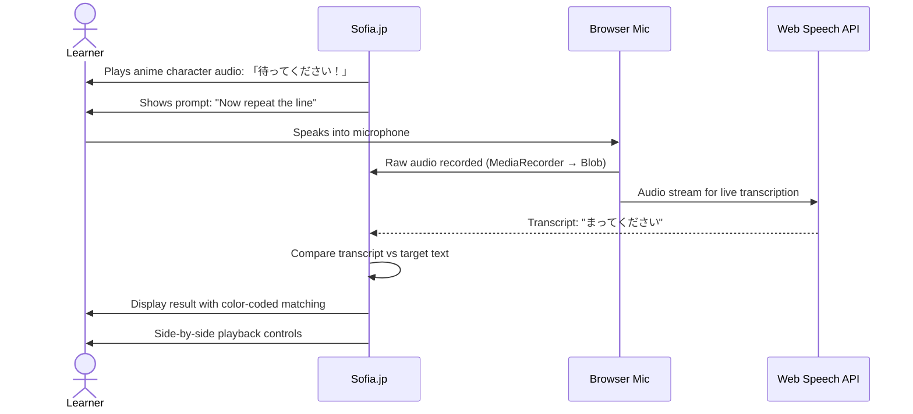
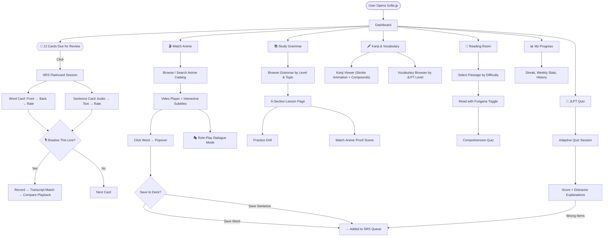
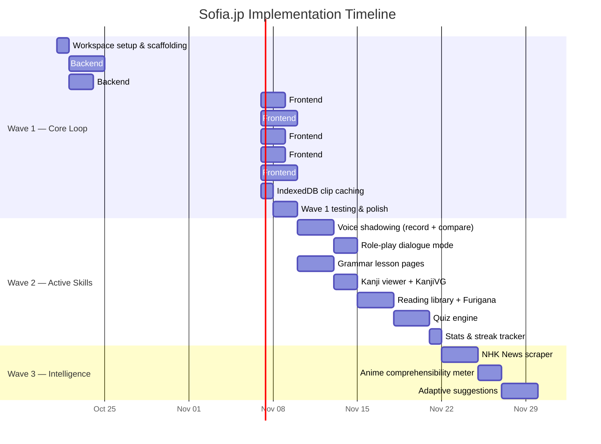

# Sofia.jp — Final Project Specification
**Version:** 2.0 (Post-Audit, All 10 Problems Resolved)  
**Date:** October 21, 2026  
**Audience:** You and your friends (private personal-use deployment)  
**Status:** Ready for scaffolding and implementation

---

## Table of Contents
1. [Project Identity & Principles](#1-project-identity--principles)
2. [The 3-Wave Build Strategy](#2-the-3-wave-build-strategy)
3. [Technology Stack (Final)](#3-technology-stack-final)
4. [Workspace & Directory Structure](#4-workspace--directory-structure)
5. [Data Sources & Content Pipeline](#5-data-sources--content-pipeline)
6. [Wave 1: Core Loop — Anime Player + Vocabulary + SRS](#6-wave-1-core-loop)
7. [Wave 2: Active Skills — Voice, Grammar, Reading, Quiz](#7-wave-2-active-skills)
8. [Wave 3: Intelligence Layer — Adaptive Engine](#8-wave-3-intelligence-layer)
9. [End-to-End User Workflow (Updated)](#9-end-to-end-user-workflow)
10. [Unified Database Schema (Final)](#10-unified-database-schema)
11. [API Specification (Final)](#11-api-specification)
12. [Frontend Component Architecture (Final)](#12-frontend-component-architecture)
13. [Offline & Sync Architecture](#13-offline--sync-architecture)
14. [Implementation Roadmap & Timeline](#14-implementation-roadmap--timeline)

---

## 1. Project Identity & Principles

**Sofia.jp** is a personal-use, all-in-one Japanese learning web application that unites anime immersion, structured grammar study, voice practice, reading comprehension, and spaced repetition into a single coherent platform.

### Design Principles (Post-Audit)

| # | Principle | What It Means in Practice |
|---|-----------|--------------------------|
| 1 | **Ship the core loop first** | A working anime player with clickable subtitles and SRS flashcards within 2 weeks. Everything else layers on top. |
| 2 | **Honest tools, not fake scores** | Voice practice uses transcript matching and self-comparison playback. No fabricated "94% accuracy" badges. |
| 3 | **User chooses, system suggests** | The dashboard shows category buttons. Users pick what to study. A "Suggested For You" card gently recommends, never forces. |
| 4 | **Sentences over isolated words** | Sentence mining is a first-class feature. Every saved item carries its full sentence context and video clip. |
| 5 | **Offline-first, sync-second** | All review sessions work with zero internet. IndexedDB caches video clips, audio, and grammar explanations. Sync happens opportunistically. |
| 6 | **Legal clarity on all content** | Open-source dictionaries (JMdict, KANJIDIC2, KanjiVG). Original example sentences for grammar. Animei API for media streaming. Public domain texts for reading. |

---

## 2. The 3-Wave Build Strategy

> [!IMPORTANT]
> This is the single most critical change from the original design. We do NOT build everything at once. Wave 1 must be usable within 2 weeks.

```mermaid
flowchart LR
    subgraph W1["Wave 1 — Core Loop (Week 1–2)"]
        W1A["Anime Player<br>+ Animei HLS Streaming"]
        W1B["Interactive Subtitle Popover<br>+ Token Click-to-Lookup"]
        W1C["Save Word + Save Sentence<br>+ Video Micro-Clip"]
        W1D["SRS Flashcard Review<br>with Looping Anime Clips"]
        W1E["JLPT Level Filter<br>on Anime Catalog"]
    end

    subgraph W2["Wave 2 — Active Skills (Week 3–5)"]
        W2A["Voice Shadowing<br>(Transcript Match + Self-Compare)"]
        W2B["Role-Play Dialogue Mode"]
        W2C["Static Grammar Lesson Pages"]
        W2D["Kanji Viewer (KanjiVG Animations)"]
        W2E["Curated Reading Library<br>+ Furigana Toggle"]
        W2F["Quiz Engine<br>(Cloze + Comprehension)"]
        W2G["Streak Tracker + Weekly Stats"]
    end

    subgraph W3["Wave 3 — Intelligence (Week 6+)"]
        W3A["Daily News Scraper (NHK Easy)"]
        W3B["Adaptive Syllabus Rebalancing"]
        W3C["Anime Comprehensibility Meter"]
        W3D["Group Leaderboard"]
    end

    W1 --> W2 --> W3
```



---

## 3. Technology Stack (Final)

| Layer | Technology | Why |
|-------|-----------|-----|
| **Frontend** | React 18 + Vite + TypeScript + Tailwind CSS | Fast dev cycle, type safety, responsive modern UI. |
| **Video Playback** | HTML5 `<video>` + `hls.js` | Native HLS streaming from Animei CDN. No transcoding needed. |
| **Client Storage** | `dexie.js` (IndexedDB wrapper) + LocalStorage | Offline video clip cache, SRS outbox, grammar explain cache. |
| **Audio Recording** | `MediaRecorder` API (browser native) | Records learner voice for playback comparison. |
| **Speech-to-Text** | Web Speech API (`SpeechRecognition`) | Free, instant, client-side transcript matching. |
| **Backend** | Python 3.11 + FastAPI + Uvicorn | Async REST gateway, proxy to Animei, content serving. |
| **NLP Tokenizer** | SudachiPy + `sudachidict_full` | Morpheme segmentation, Furigana injection, lemma extraction. |
| **Database** | SQLite + SQLModel | Lightweight, zero-config, ACID-compliant. Perfect for personal use. |
| **Dictionaries** | JMdict (CC-BY-SA) + KANJIDIC2 (CC-BY-SA) | Gold-standard open-source Japanese-English lexicon data. |
| **Kanji Visuals** | KanjiVG (CC-BY-SA) + `dmak.js` | Animated stroke order rendering for 12,000+ characters. |
| **TTS Audio** | `edge-tts` (free, no API key) | High-quality Japanese text-to-speech for word/sentence audio. |

---

## 4. Workspace & Directory Structure

> [!NOTE]
> **Fix for Problem 1 (Workspace Pollution).** Research docs, tools, and application code are cleanly separated.

```
D:\sofia.jp\
├── docs/                          # Research & reference documents
│   ├── RESOURCE.md                # JLPT Benkyo analysis
│   ├── MINNA_NIHONGO_RESOURCE.md  # Minna no Nihongo analysis
│   ├── JAPANESETEST4YOU_RESOURCE.md
│   ├── JAPANESEJLPT_RESOURCE.md
│   ├── AIRLEARN_VOICE_RESOURCE.md
│   ├── ANIMEI_LEARNING_RESOURCE.md
│   └── sources.txt                # Reference URLs
│
├── backend/                       # FastAPI Python server
│   ├── app/
│   │   ├── main.py               # FastAPI app entry
│   │   ├── routers/              # API route modules
│   │   │   ├── anime.py          # Animei proxy + catalog
│   │   │   ├── vocabulary.py     # Word/sentence CRUD + SRS
│   │   │   ├── grammar.py        # Grammar lesson serving
│   │   │   ├── reading.py        # Reading library serving
│   │   │   ├── quiz.py           # Question generation + grading
│   │   │   └── explain.py        # Grammar explain (Animei + fallback)
│   │   ├── services/
│   │   │   ├── animei_client.py  # HTTP client for Animei API
│   │   │   ├── tokenizer.py      # SudachiPy wrapper
│   │   │   ├── srs_engine.py     # SM-2 interval calculator
│   │   │   └── tts.py            # edge-tts audio generator
│   │   ├── models/               # SQLModel ORM definitions
│   │   ├── data/                 # Static bundled data
│   │   │   ├── jmdict_subset.json
│   │   │   ├── kanjidic2.json
│   │   │   ├── grammar_n5_n3.json  # Pre-written grammar breakdowns
│   │   │   └── readings/           # Curated reading passages
│   │   └── database.py           # SQLite connection + init
│   ├── requirements.txt
│   └── Dockerfile
│
├── frontend/                      # React 18 + Vite + TypeScript
│   ├── src/
│   │   ├── pages/                # Route-level page components
│   │   ├── components/           # Reusable UI components
│   │   ├── stores/               # Zustand state management
│   │   ├── services/             # API client + IndexedDB helpers
│   │   ├── hooks/                # Custom React hooks
│   │   └── assets/               # Static images, icons
│   ├── public/
│   ├── index.html
│   ├── package.json
│   ├── tsconfig.json
│   ├── tailwind.config.ts
│   └── vite.config.ts
│
├── tools/                         # External tooling (isolated)
│   └── rea/                       # Reverse engineering assistant
│
├── storage/                       # Runtime data (gitignored)
│   └── sofia.db                   # SQLite database file
│
└── PROJECT_SPEC.md                # This file
```

---

## 5. Data Sources & Content Pipeline

> [!NOTE]
> **Fix for Problem 9 (Minna no Nihongo Legal Clarity)** and **Problem 4 (News Cold Start).**

### 5.1 Anime Catalog & Video Streams — From Animei (Live API)

Sofia.jp proxies the Animei backend. No video files are stored locally.

| Animei Endpoint | What Sofia.jp Uses It For |
|-----------------|--------------------------|
| `GET /api/v1/catalog/popular` | Browse popular anime with posters and metadata. |
| `GET /api/v1/catalog/search?q={query}` | Search anime by Japanese or Romaji title. |
| `GET /api/v1/catalog/anime/{shikimoriId}` | Get episode list with streaming IDs and hashes. |
| `GET /api/v1/catalog/stream?type=seria&id={epId}&hash={hash}` | Get multi-resolution HLS `.m3u8` URLs (360p, 480p, 720p). |
| `GET /api/v1/subtitles/episode?title={romaji}&episode={num}&shikimoriId={id}&translate=en` | Get millisecond-accurate bilingual subtitles with morphological tokens. |
| `POST /api/v1/words/clip` | Generate 3–6 second video micro-clips for SRS flashcards. |
| `GET /api/v1/explain?sentence={s}&word={w}&lang=en` | AI grammar breakdown (translation, particles, mnemonics). |
| `GET /api/v1/dictionary?word={w}` | Dictionary lookup for word popover. |

### 5.2 Vocabulary & Kanji — From Open Dictionaries

| Source | License | Content |
|--------|---------|---------|
| **JMdict** | CC-BY-SA 4.0 | 200,000+ Japanese-English word entries with readings, meanings, POS, JLPT tags. |
| **KANJIDIC2** | CC-BY-SA 4.0 | 13,000+ Kanji with stroke counts, radicals, Onyomi/Kunyomi, English meanings, JLPT/Grade. |
| **KanjiVG** | CC-BY-SA 3.0 | SVG stroke order data for 12,000+ Kanji characters. |

### 5.3 Grammar Lessons — Original Content

> **Fix for Problem 9:** We reference the Minna no Nihongo lesson ordering (Lesson 1 teaches `〜です`, Lesson 14 teaches `〜てください`) as a structural framework, but all example sentences, explanations, and drill content are written originally.

The grammar database is a bundled JSON file (`grammar_n5_n3.json`) containing 200+ grammar patterns with:
- Pattern formula and conjugation rules.
- 3 original example sentences per pattern (not copied from any textbook).
- Nuance notes and common pitfalls.
- Cross-reference to anime scenes that demonstrate the pattern.

### 5.4 Reading Library — Public Domain & Creative Commons

> **Fix for Problem 4:** No scraper dependency in Wave 1–2. Static curated library first.

| Tier | JLPT Level | Content Source |
|------|------------|----------------|
| **Tier 1 (Easy)** | N5–N4 | Japanese fairy tales (桃太郎, かぐや姫, 浦島太郎), graded reader passages. All public domain. |
| **Tier 2 (Intermediate)** | N3 | Simple Wikipedia Japanese articles, adapted NHK-style summaries. |
| **Tier 3 (Advanced)** | N2–N1 | Aozora Bunko (Japan's Project Gutenberg) short stories. Fully public domain. |

Each passage is pre-processed with SudachiPy to inject Furigana annotations and JLPT vocabulary tags.

### 5.5 Grammar Explain Fallback Chain

> **Fix for Problem 10 (Animei Dependency).** Three-tier fallback ensures grammar explanations never fail.

```
Tier 1: Animei Live API   →  GET /api/v1/explain
        ↓ (on failure or offline)
Tier 2: IndexedDB Cache    →  Previously fetched explanations stored locally
        ↓ (cache miss)
Tier 3: Bundled Static     →  grammar_n5_n3.json (top 500 patterns, ships with the app)
```

---

## 6. Wave 1: Core Loop

> [!IMPORTANT]
> **Fix for Problem 1 (Over-Engineering).** This is the minimum viable product. Target: 2 weeks to a working prototype.

### 6.1 Feature: Anime Catalog & Search

**What the user sees:** A grid of anime posters with titles, episode counts, and JLPT difficulty badges. A search bar filters by title.

**How it works:**
1. Frontend calls `GET /api/sofia/catalog/popular` on Sofia.jp backend.
2. Sofia.jp backend proxies to `GET /api/v1/catalog/popular` on Animei.
3. Response includes poster URLs from Shikimori CDN, rendered as lazy-loaded image cards.
4. User clicks an anime → loads episode list → clicks episode → enters the player.

### 6.2 Feature: Anime Player with Interactive Subtitles

**What the user sees:** A video player occupying the top half of the screen. Below it, a scrollable transcript panel with every dialogue line. The currently playing line is highlighted. Each Japanese word is a separate clickable element.

**How it works:**
1. Frontend requests HLS stream URL via Sofia.jp proxy → Animei `catalog/stream`.
2. `hls.js` attaches to `<video>` element and begins playback.
3. Frontend requests tokenized subtitles via Sofia.jp proxy → Animei `subtitles/episode`.
4. Subtitles are rendered as `<div class="segment">` elements containing `<span class="token">` for each morpheme.
5. A `requestAnimationFrame` sync loop highlights the active segment based on `video.currentTime`.
6. Segment controls: Replay, Loop, Prev/Next, Speed (0.75x–1.5x).

### 6.3 Feature: Word & Sentence Saving with Video Clips

> **Fix for Problem 6 (Missing Sentence Mining).**

**What the user sees:** Clicking any word token pauses the video and opens a slide-up modal with:

```
┌─────────────────────────────────────────────┐
│  SAVE TO YOUR DECK                          │
│                                             │
│  Word:     食べる                            │
│  Reading:  たべる                            │
│  Meaning:  to eat                           │
│  JLPT:     N5                               │
│                                             │
│  Sentence: お前も食べるか？                    │
│  Translation: You wanna eat too?             │
│  Anime:    Naruto — Episode 1                │
│                                             │
│  📝 Personal Note: [_______________]         │
│  🏷️ Tags:  [slang] [casual] [N5]            │
│                                             │
│  [💾 Save Word]  [📝 Save Full Sentence]    │
│           [✖ Cancel]                        │
└─────────────────────────────────────────────┘
```

**Two save modes:**
- **Save Word:** Creates a vocabulary flashcard keyed to the base dictionary form. Stores the video clip reference (start/end timestamps + episode ID).
- **Save Full Sentence:** Creates a sentence flashcard where the front plays the audio clip and the back shows the full Japanese text, English translation, and looping video.

Both modes trigger the Animei `words/clip` endpoint to generate a 3–6 second MP4 micro-clip, which is cached in IndexedDB.

### 6.4 Feature: SRS Flashcard Review with Looping Clips

**What the user sees:** A card-based review interface.

**Word Card:**
- **Front:** Target Kanji/Word displayed large. Audio play button. "Show Answer" button.
- **Back (on flip):**
  - Furigana reading + English meaning.
  - Looping video clip of the anime scene (loaded from IndexedDB cache or streamed).
  - Full sentence context with token-level breakdown.
  - Grammar explain button (3-tier fallback).
  - Rating buttons: `[Again]` `[Hard]` `[Good]` `[Easy]`

**Sentence Card:**
- **Front:** Audio clip plays the character's full line. Screen shows only "Listen and recall the meaning." "Show Answer" button.
- **Back (on flip):**
  - Full Japanese text with Furigana.
  - English translation.
  - Looping video clip.
  - Personal note and tags.
  - Rating buttons.

**SRS Algorithm:**
$$\text{Interval}_{\text{next}} = \begin{cases} 1\text{ min (re-queue in session)} & \text{Again} \\ 1\text{ day} & \text{Hard} \\ \min(\text{round}(\text{prev} \times 2.2), 365) & \text{Good} \\ 120\text{ days (triage skip)} & \text{Easy} \end{cases}$$

### 6.5 Feature: JLPT Level Filter

The anime catalog and vocabulary lists can be filtered by JLPT level. Animei subtitle tokens include a `learnable` flag and POS data. Sofia.jp cross-references against JMdict to tag each token's JLPT tier (N5 through N1).

---

## 7. Wave 2: Active Skills

### 7.1 Feature: Voice Shadowing (Transcript Match + Self-Compare)

> **Fix for Problem 2 (Overcomplicated Voice Assessment).**

**What the user sees:** While reviewing a flashcard or watching a scene, a "Shadow This Line" button appears.

**The flow:**



**Result display:**

```
Target:  待って ください ！
You said: 待って ください
           ✅      ✅

🔊 [Play Native Audio]  🔊 [Play Your Recording]
```

- Matched words are highlighted **green**.
- Missing or misrecognized words are highlighted **red**.
- Two playback buttons let the learner hear their own voice next to the native character's voice.
- **No fake percentage scores.** The learner judges their own quality by listening to the comparison.

### 7.2 Feature: Role-Play Dialogue Mode

> **Fix for Problem 7 (Missing Conversation Practice).**

**What the user sees:** A special mode available on scenes with 2+ characters speaking alternately.

**The flow:**
1. Sofia.jp identifies alternating speaker segments in the subtitle data (heuristic: consecutive segments with different speakers or back-and-forth pattern).
2. The learner picks which character to play (Character A or Character B).
3. Sofia.jp plays Character A's line (video + audio).
4. Video pauses. Microphone activates. The learner speaks Character B's line.
5. Web Speech API transcribes and color-matches against the expected text.
6. Video resumes with the next Character A line.
7. Cycle continues through the dialogue.

**Example (Naruto Ep 1):**

```
🎬 Iruka (plays):  「ナルト！今度は何をやったんだ？」
🎤 You (speak):    「へへ、すげえだろ？」
   Match result:    ✅ へへ  ✅ すげえ  ✅ だろ
🎬 Iruka (plays):  「すごくない！」
🎤 You (speak):    「______」
```

This reuses 100% of the existing subtitle data and audio. No new backend work needed — it is purely a frontend playback orchestration feature.

### 7.3 Feature: Static Grammar Lesson Pages

> **Fix for Problem 9 (Minna no Nihongo Legal Clarity).**

**What the user sees:** A structured lesson browser organized by JLPT level and topic.

**Content per grammar point:**

| Section | Content | Source |
|---------|---------|--------|
| **Pattern Formula** | Conjugation template (e.g., `Verb [て-form] + ください`) | Original |
| **Meaning & Register** | When and why to use this pattern, formality level | Original |
| **Example Sentences (×3)** | Original Japanese sentences with Furigana, Romaji, English | Original (not from any textbook) |
| **Common Pitfalls** | Confusion table vs. similar patterns | Original |
| **Anime Proof** | Link to a specific anime scene timestamp demonstrating this pattern | Cross-reference from Animei subtitles |
| **Practice Drill** | 1–2 fill-in-the-blank exercises | Original |

Grammar points are sequenced following the standard beginner→advanced ordering (similar to Minna no Nihongo lesson flow) but all content is independently authored.

### 7.4 Feature: Kanji Viewer with KanjiVG Animations

> **Fix for Problem 3 (Stroke Order Canvas Is a Rabbit Hole).**

**What the user sees:** A Kanji detail page showing:

```
┌─────────────────────────────────────────┐
│  漢字: 食                               │
│  Strokes: 9    Grade: 2    JLPT: N5    │
│                                         │
│  ▶ [Play Stroke Animation]              │
│  (KanjiVG animated SVG rendering)       │
│                                         │
│  Onyomi:  ショク、ジキ                    │
│  Kunyomi: た.べる、く.う                  │
│  Meaning: eat, food, meal               │
│                                         │
│  Radical: 食 (eat) — #184               │
│  Mnemonic: "A person (人) sitting at     │
│  a table (良) eating food"              │
│                                         │
│  Common Compounds:                      │
│  • 食べる (たべる) — to eat              │
│  • 食事 (しょくじ) — meal               │
│  • 食堂 (しょくどう) — cafeteria        │
│  • 朝食 (ちょうしょく) — breakfast       │
│                                         │
│  🎬 Anime Sightings:                    │
│  • Naruto Ep3: 「ラーメン食べたい」       │
│  [Practice Canvas — Freeform Drawing]   │
└─────────────────────────────────────────┘
```

- **Animated stroke order** is rendered by `dmak.js` consuming KanjiVG SVG data. No custom stroke recognition engine needed.
- **Practice canvas** is a simple HTML5 Canvas for freeform drawing — the user compares their strokes visually against the animation. No algorithmic grading.
- **Anime Sightings** are auto-generated by querying saved vocabulary and subtitle data for sentences containing the target Kanji.

### 7.5 Feature: Curated Reading Library with Furigana Toggle

> **Fix for Problem 4 (News Cold Start).**

**What the user sees:** A reading room with tiered difficulty tabs.

**Furigana Toggle Modes:**

| Mode | Behavior | Best For |
|------|----------|----------|
| **Full Furigana** | Ruby text above every Kanji | N5 beginners |
| **JLPT Filtered** | Furigana only for Kanji above learner's set level | Intermediate learners pushing boundaries |
| **Hover Reveal** | Clean Kanji text; hovering shows Furigana | Advanced reading practice |
| **Off** | Raw Japanese text, no assistance | Pre-exam simulation |

**Interactive features:**
- Click any word → dictionary popover with meaning, JLPT tag, audio, and "Save to Deck" button.
- Each passage ends with 2–3 comprehension questions (multiple-choice, JLPT Dokkai style).
- Audio narration toggle (generated via `edge-tts` and pre-cached).

### 7.6 Feature: Quiz Engine

**Question types available:**
1. **Particle Cloze:** `東京 ［？］ 行きます` → Pick `に` / `で` / `を` / `が`.
2. **Vocabulary Meaning:** "What does `計画` mean in this sentence?" → 4 options.
3. **Listening Cloze:** Play an anime audio clip, fill in the blanked word.
4. **Sentence Ordering:** Drag tiles into the correct Japanese word order.
5. **Reading Comprehension:** After reading a passage, answer intent/context questions.

Every incorrect answer shows:
- The correct answer highlighted.
- A 1-sentence explanation of *why* the distractor was wrong.
- A "Review This Item" button that adds it to the SRS queue.

### 7.7 Feature: Streak Tracker & Weekly Stats Card

> **Fix for Problem 8 (Missing Progress Sharing).**

**What the user sees on the dashboard:**

```
┌──────────────────────────────────────────────┐
│  🔥 Current Streak: 14 Days                 │
│                                              │
│  This Week:                                  │
│  📝 52 words reviewed   🆕 18 new words      │
│  🎬 6 anime scenes watched                   │
│  🎙️ 8 lines shadowed                        │
│  📖 2 reading passages completed             │
│  📊 JLPT Quiz Score: 82% (N4)               │
│                                              │
│  [📸 Share Stats Card]  [📊 Full History]    │
└──────────────────────────────────────────────┘
```

- `[Share Stats Card]` generates a styled PNG image the user can screenshot or share with friends.
- Daily streak increments when at least 1 SRS review is completed.

---

## 8. Wave 3: Intelligence Layer

> **Fix for Problem 5 (Adaptive Engine Premature).** These features are built ONLY after Waves 1–2 are stable and generating real usage data.

### 8.1 Daily News Scraper (NHK Easy)
- Background cron worker scrapes NHK News Web Easy RSS every 6 hours.
- Articles are processed through SudachiPy for Furigana injection and JLPT tagging.
- Stored in `reading_articles` table and served alongside the static curated library.

### 8.2 Adaptive Syllabus Rebalancing
- After accumulating 2+ weeks of usage data, the system begins tracking per-skill mastery vectors.
- The "Suggested For You" dashboard card becomes increasingly personalized:
  - If quiz particle accuracy drops below 70%, it recommends specific grammar lessons.
  - If SRS lapse rate spikes, it suggests reducing new card intake.
  - If the user watches lots of anime but never does grammar lessons, it gently nudges toward structured study.

### 8.3 Anime Comprehensibility Meter
- For each anime episode, cross-reference the subtitle vocabulary against the user's known vocabulary set.
- Display a personalized badge: "You know 88% of the words in this episode."
- Sort the catalog by comprehensibility so the user always finds content at their sweet spot.

### 8.4 Group Leaderboard
- If multiple friends share the same Sofia.jp backend, display a simple weekly leaderboard:
  - Words learned, streak length, quiz scores, anime episodes watched.
- No complex social features — just friendly competition.

---

## 9. End-to-End User Workflow (Updated)

> [!IMPORTANT]
> **Fix for Problem 5.** The user controls their own journey. The dashboard presents choices, not a forced routine.



---

## 10. Unified Database Schema (Final)

> [!NOTE]
> **Fix for Problem from earlier audit (Split-Brain Database).** All tables use JMdict IDs as the canonical key for vocabulary cross-referencing.

```sql
-- =============================================
-- CORE LEXICON (From JMdict + KANJIDIC2)
-- =============================================
CREATE TABLE IF NOT EXISTS dictionary_words (
    jmdict_id INTEGER PRIMARY KEY,        -- Canonical JMdict entry ID
    word TEXT NOT NULL,                    -- Kanji representation
    reading TEXT NOT NULL,                 -- Hiragana reading
    romaji TEXT,
    meanings_json TEXT NOT NULL,           -- JSON: ["to eat", "to consume"]
    pos TEXT,                             -- Part of speech
    jlpt_level TEXT CHECK(jlpt_level IN ('N5','N4','N3','N2','N1')),
    pitch_accent TEXT,
    common INTEGER DEFAULT 0              -- 1 if frequently used
);

CREATE TABLE IF NOT EXISTS dictionary_kanji (
    kanji TEXT PRIMARY KEY,               -- Single character: 食
    strokes INTEGER NOT NULL,
    grade INTEGER,
    jlpt_level TEXT CHECK(jlpt_level IN ('N5','N4','N3','N2','N1')),
    radical TEXT,
    radical_meaning TEXT,
    onyomi_json TEXT,                     -- JSON array
    kunyomi_json TEXT,                    -- JSON array
    meanings_json TEXT,                   -- JSON array
    kanjivg_svg TEXT,                     -- KanjiVG stroke order SVG path
    mnemonic TEXT
);

CREATE TABLE IF NOT EXISTS kanji_compounds (
    id INTEGER PRIMARY KEY AUTOINCREMENT,
    kanji TEXT NOT NULL REFERENCES dictionary_kanji(kanji),
    compound TEXT NOT NULL,
    reading TEXT NOT NULL,
    meaning TEXT NOT NULL,
    jlpt_level TEXT
);

-- =============================================
-- GRAMMAR LESSONS
-- =============================================
CREATE TABLE IF NOT EXISTS grammar_points (
    id TEXT PRIMARY KEY,                  -- e.g. "N5_TE_KUDASAI"
    pattern TEXT NOT NULL,                -- e.g. "Verb [て-form] + ください"
    meaning TEXT NOT NULL,
    jlpt_level TEXT NOT NULL,
    lesson_order INTEGER,                 -- Sequencing (inspired by Minna lesson #)
    explanation TEXT NOT NULL,
    nuance TEXT,
    pitfalls TEXT,
    examples_json TEXT NOT NULL,          -- JSON: 3 original example sentences
    anime_scene_refs_json TEXT            -- JSON: links to anime scenes
);

-- =============================================
-- READING LIBRARY
-- =============================================
CREATE TABLE IF NOT EXISTS reading_passages (
    id TEXT PRIMARY KEY,
    title TEXT NOT NULL,
    title_furigana TEXT,
    difficulty TEXT CHECK(difficulty IN ('easy','medium','hard')),
    jlpt_level TEXT,
    category TEXT,                        -- fairy_tale, news, literature
    content_plain TEXT NOT NULL,
    content_furigana TEXT NOT NULL,        -- Pre-annotated with <ruby> tags
    content_english TEXT,
    audio_url TEXT,
    source_attribution TEXT NOT NULL       -- "Public Domain" / "CC-BY" / etc.
);

CREATE TABLE IF NOT EXISTS reading_questions (
    id TEXT PRIMARY KEY,
    passage_id TEXT NOT NULL REFERENCES reading_passages(id),
    question_text TEXT NOT NULL,
    options_json TEXT NOT NULL,            -- JSON: 4 option strings
    correct_index INTEGER NOT NULL,
    explanation TEXT NOT NULL
);

-- =============================================
-- USER DATA: SAVED ITEMS (Words + Sentences)
-- =============================================
CREATE TABLE IF NOT EXISTS user_saved_items (
    id TEXT PRIMARY KEY,
    item_type TEXT NOT NULL CHECK(item_type IN ('word', 'sentence')),
    -- Word fields
    jmdict_id INTEGER REFERENCES dictionary_words(jmdict_id),
    word TEXT NOT NULL,
    reading TEXT NOT NULL,
    meaning TEXT NOT NULL,
    -- Sentence context (always populated)
    sentence_jp TEXT NOT NULL,
    sentence_en TEXT NOT NULL,
    -- Anime reference
    anime_title TEXT,
    episode_number INTEGER,
    clip_start REAL,
    clip_end REAL,
    clip_cached INTEGER DEFAULT 0,        -- 1 if blob is in IndexedDB
    -- User-added metadata
    personal_note TEXT DEFAULT '',
    tags_json TEXT DEFAULT '[]',           -- JSON: ["slang", "keigo", "N3"]
    created_at DATETIME DEFAULT CURRENT_TIMESTAMP
);

-- =============================================
-- USER DATA: SRS SCHEDULE
-- =============================================
CREATE TABLE IF NOT EXISTS user_srs (
    item_id TEXT PRIMARY KEY REFERENCES user_saved_items(id),
    interval_days INTEGER NOT NULL DEFAULT 0,
    repetitions INTEGER NOT NULL DEFAULT 0,
    lapses INTEGER NOT NULL DEFAULT 0,
    ease_factor REAL NOT NULL DEFAULT 2.2,
    due_date DATE NOT NULL,
    last_reviewed_at DATETIME,
    created_at DATETIME DEFAULT CURRENT_TIMESTAMP
);
CREATE INDEX IF NOT EXISTS idx_srs_due ON user_srs(due_date);

-- =============================================
-- USER DATA: REVIEW EVENT LOG (Immutable)
-- =============================================
-- Fix for Problem 2.5 (Multi-Device Sync):
-- Instead of overwriting card state, we log immutable events.
CREATE TABLE IF NOT EXISTS user_review_events (
    id TEXT PRIMARY KEY,
    item_id TEXT NOT NULL REFERENCES user_saved_items(id),
    grade TEXT NOT NULL CHECK(grade IN ('again','hard','good','easy')),
    response_time_ms INTEGER,
    reviewed_at DATETIME NOT NULL DEFAULT CURRENT_TIMESTAMP
);

-- =============================================
-- USER DATA: QUIZ ATTEMPTS
-- =============================================
CREATE TABLE IF NOT EXISTS user_quiz_attempts (
    id TEXT PRIMARY KEY,
    question_source TEXT,                 -- "grammar_drill", "reading_quiz", "jlpt_mock"
    question_text TEXT NOT NULL,
    selected_answer TEXT,
    correct_answer TEXT NOT NULL,
    is_correct INTEGER NOT NULL CHECK(is_correct IN (0, 1)),
    related_grammar_id TEXT REFERENCES grammar_points(id),
    related_jmdict_id INTEGER REFERENCES dictionary_words(jmdict_id),
    attempted_at DATETIME DEFAULT CURRENT_TIMESTAMP
);

-- =============================================
-- USER DATA: VOICE SHADOWING LOG
-- =============================================
CREATE TABLE IF NOT EXISTS user_voice_attempts (
    id TEXT PRIMARY KEY,
    item_id TEXT REFERENCES user_saved_items(id),
    target_text TEXT NOT NULL,
    recognized_text TEXT,
    match_ratio REAL,                     -- 0.0 to 1.0 (words matched / total words)
    attempted_at DATETIME DEFAULT CURRENT_TIMESTAMP
);

-- =============================================
-- USER DATA: STREAK & STATS
-- =============================================
CREATE TABLE IF NOT EXISTS user_daily_stats (
    stat_date DATE PRIMARY KEY,
    words_reviewed INTEGER DEFAULT 0,
    new_words_added INTEGER DEFAULT 0,
    sentences_reviewed INTEGER DEFAULT 0,
    anime_scenes_watched INTEGER DEFAULT 0,
    voice_attempts INTEGER DEFAULT 0,
    readings_completed INTEGER DEFAULT 0,
    quiz_correct INTEGER DEFAULT 0,
    quiz_total INTEGER DEFAULT 0
);

-- =============================================
-- GRAMMAR EXPLAIN CACHE (Offline Fallback)
-- =============================================
CREATE TABLE IF NOT EXISTS explain_cache (
    cache_key TEXT PRIMARY KEY,           -- "en|word|sentence" hash
    explanation_json TEXT NOT NULL,
    fetched_at DATETIME DEFAULT CURRENT_TIMESTAMP
);
```

---

## 11. API Specification (Final)

### Sofia.jp Backend Routes

```python
# ============================================
# ANIME & MEDIA (Proxies to Animei)
# ============================================
GET  /api/anime/popular                  # → Animei catalog/popular
GET  /api/anime/search?q={query}         # → Animei catalog/search
GET  /api/anime/{shikimoriId}            # → Animei catalog/anime/{id}
GET  /api/anime/stream                   # → Animei catalog/stream
GET  /api/anime/subtitles                # → Animei subtitles/episode
POST /api/anime/clip                     # → Animei words/clip

# ============================================
# VOCABULARY & SAVED ITEMS (Local)
# ============================================
GET    /api/vocabulary?jlpt={level}      # Browse JMdict vocabulary by level
GET    /api/saved-items                  # Get all user saved words/sentences
POST   /api/saved-items                  # Save a new word or sentence
DELETE /api/saved-items/{id}             # Delete a saved item
PATCH  /api/saved-items/{id}             # Update notes/tags

# ============================================
# SRS REVIEW (Local)
# ============================================
GET  /api/srs/due                        # Get today's due cards
POST /api/srs/review                     # Submit review grade → recalculate interval

# ============================================
# GRAMMAR (Local + Animei Fallback)
# ============================================
GET  /api/grammar?level={N5..N1}         # List grammar points by level
GET  /api/grammar/{id}                   # Get full grammar lesson
GET  /api/explain?sentence={s}&word={w}  # 3-tier explain (Animei → Cache → Static)

# ============================================
# KANJI (Local)
# ============================================
GET  /api/kanji/{character}              # Full kanji detail + compounds + SVG
GET  /api/kanji?level={N5..N1}           # Browse kanji by JLPT level

# ============================================
# READING (Local)
# ============================================
GET  /api/reading?difficulty={tier}      # List reading passages
GET  /api/reading/{id}                   # Get passage + questions
POST /api/reading/{id}/answer            # Submit quiz answer

# ============================================
# QUIZ (Local)
# ============================================
GET  /api/quiz/generate?level={N5..N1}&type={cloze|meaning|ordering}
POST /api/quiz/answer                    # Submit answer → explanation + SRS flag

# ============================================
# STATS (Local)
# ============================================
GET  /api/stats/streak                   # Current streak + weekly summary
GET  /api/stats/history                  # Full daily stats history
```

---

## 12. Frontend Component Architecture (Final)

```
<App>
├── <Sidebar>                              # Navigation: Dashboard, Anime, Grammar, etc.
├── <Routes>
│   ├── /dashboard → <DashboardPage>
│   │   ├── <DueCardsBadge>               # "12 cards due" notification
│   │   ├── <SuggestedForYouCard>         # Smart recommendation (Wave 3)
│   │   ├── <StreakCounter>
│   │   ├── <WeeklyStatsCard>
│   │   └── <QuickActionGrid>             # Anime, Grammar, Kanji, Reading, Quiz
│   │
│   ├── /anime → <AnimeCatalogPage>
│   │   ├── <SearchBar>
│   │   ├── <JlptFilterChips>
│   │   └── <AnimeGrid> → <AnimeCard>
│   │
│   ├── /anime/:id → <AnimePlayerPage>
│   │   ├── <VideoPlayer>                 # hls.js + <video> element
│   │   │   ├── <SubtitleOverlay>         # Live subtitle on video
│   │   │   └── <PlayerControls>          # Play, Replay, Loop, Speed, Prev/Next
│   │   ├── <TranscriptPanel>             # Scrollable subtitle list
│   │   │   └── <SegmentLine>
│   │   │       └── <TokenSpan>           # Clickable word with reading tooltip
│   │   ├── <SaveItemModal>               # Word/Sentence save form
│   │   └── <RolePlayOverlay>             # Dialogue mode UI
│   │
│   ├── /review → <SrsReviewPage>
│   │   ├── <CardFront>                   # Word or sentence prompt
│   │   ├── <CardBack>
│   │   │   ├── <LoopingClipPlayer>       # Cached IndexedDB video
│   │   │   ├── <SentenceBreakdown>
│   │   │   ├── <ExplainSection>          # 3-tier grammar explain
│   │   │   └── <VoiceShadowButton>       # Record + compare
│   │   ├── <RatingButtons>               # Again, Hard, Good, Easy
│   │   └── <SessionProgressBar>
│   │
│   ├── /grammar → <GrammarListPage>
│   │   └── /grammar/:id → <GrammarLessonPage>
│   │       ├── <PatternFormula>
│   │       ├── <ExampleSentences>
│   │       ├── <PitfallsTable>
│   │       ├── <AnimeProofClip>
│   │       └── <PracticeDrill>
│   │
│   ├── /kanji → <KanjiBrowserPage>
│   │   └── /kanji/:char → <KanjiDetailPage>
│   │       ├── <StrokeOrderAnimation>    # dmak.js + KanjiVG
│   │       ├── <ReadingsTable>
│   │       ├── <CompoundsList>
│   │       ├── <MnemonicCard>
│   │       ├── <AnimeSightings>
│   │       └── <PracticeCanvas>          # Freeform drawing
│   │
│   ├── /reading → <ReadingRoomPage>
│   │   └── /reading/:id → <ReadingPassagePage>
│   │       ├── <FuriganaToggle>
│   │       ├── <PassageContent>          # Clickable tokens
│   │       ├── <AudioNarrationPlayer>
│   │       └── <ComprehensionQuiz>
│   │
│   ├── /quiz → <QuizPage>
│   │   ├── <QuizSettings>                # Level, type selection
│   │   ├── <QuestionCard>
│   │   └── <QuizResults>
│   │
│   └── /stats → <StatsPage>
│       ├── <StreakCalendar>
│       ├── <WeeklyBreakdown>
│       └── <ShareStatsCard>
│
└── <VoiceShadowModal>                     # Global overlay for mic recording
    ├── <WaveformVisualizer>
    ├── <TranscriptMatchDisplay>
    └── <PlaybackCompareControls>
```

---

## 13. Offline & Sync Architecture

```mermaid
flowchart TD
    subgraph BROWSER["Browser (Offline-First)"]
        IDB[("IndexedDB<br>• Video clip blobs<br>• Audio blobs<br>• Explain JSON cache")]
        LS[("LocalStorage<br>• SRS outbox queue<br>• Session state<br>• User preferences")]
        SW["Service Worker<br>(Cache API shell + static assets)"]
    end

    subgraph SERVER["Sofia.jp Backend"]
        API["FastAPI Gateway"]
        DB[("SQLite")]
    end

    IDB <-->|Read/Write clips| BROWSER
    LS -->|On 'online' event| API
    API --> DB
    SW -->|Cache static assets| BROWSER

    style IDB fill:#1e3a5f
    style LS fill:#1e3a5f
```



**Outbox pattern for SRS reviews:**
1. When the user grades a card, the review event is written to both SQLite (if online) and LocalStorage outbox (always).
2. If the network is unavailable, events accumulate in the outbox (capped at 500).
3. On `window.addEventListener('online')` or periodic 30-second timer, the outbox flushes all pending events to the backend.
4. Events are immutable and idempotent — replaying them produces the same SRS state regardless of device or timing.

---

## 14. Implementation Roadmap & Timeline



---

> [!TIP]
> This document is the **single source of truth** for building Sofia.jp. All 10 identified problems have been resolved and integrated. The next step is to organize the workspace and scaffold the codebase.

*End of PROJECT_SPEC.md*
