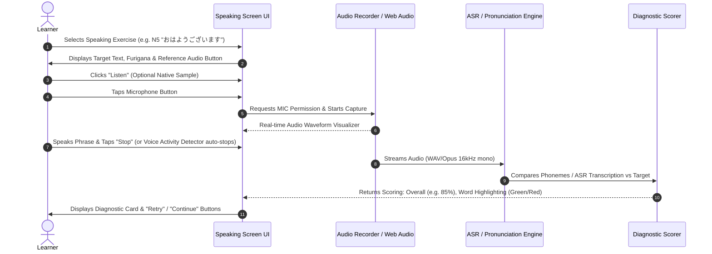
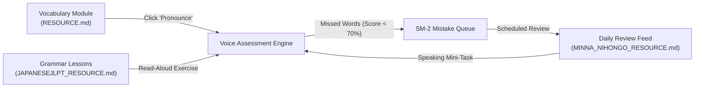

# Voice Assessment Systems Specification: JADX APK Decompilation Analysis & Sofia.jp Japanese Speech Engine Architecture

> **Document Version:** 2.0.0 (Updated with Full JADX Decompilation Evidence)  
> **Target Analyzed:** Local APK artifact at `D:\downloads\airlean\airlearn.apk`  
> **Output Deliverable:** `D:\sofia.jp\AIRLEARN_VOICE_RESOURCE.md`  
> **Inspection Date:** October 20, 2026  
> **Preserved Project Research Artifacts:**  
> - [RESOURCE.md](file:///D:/sofia.jp/RESOURCE.md) *(JLPT Benkyo Reverse Engineering & Shared Library Core)*  
> - [MINNA_NIHONGO_RESOURCE.md](file:///D:/sofia.jp/MINNA_NIHONGO_RESOURCE.md) *(Minna no Nihongo Analysis & Level-Based Feed)*  
> - [JAPANESETEST4YOU_RESOURCE.md](file:///D:/sofia.jp/JAPANESETEST4YOU_RESOURCE.md) *(JapaneseTest4You Analysis & JLPT Testing Engine)*  
> - [JAPANESEJLPT_RESOURCE.md](file:///D:/sofia.jp/JAPANESEJLPT_RESOURCE.md) *(JapaneseJLPT Analysis & Guided Lessons)*  
> **JADX Decompilation Output Directory:** `C:\Users\mukes\.gemini\antigravity\brain\62dda308-eb70-4559-8f7d-eb55c8908890\scratch\jadx_decompiled\`  
> **Methodology:** Static Dalvik Executable (DEX) decompilation via **JADX v1.5.6**, Google Android SDK Build-Tools 36.0.0 (`aapt.exe`), binary XML manifest extraction, class-hierarchy code inspection, and clean-room voice assessment system design.

---

## 1. Research Objective & Date

### 1.1 Objective
Inspect the local APK file provided at `D:\downloads\airlean\airlearn.apk` using **JADX** and **REA** to understand the voice-assessment, audio recording, and pronunciation evaluation architecture of the Airlearn language learning mobile application. The empirical findings will be used to design an original, independent, and ethically sound **Japanese Voice Assessment & Pronunciation Practice Subsystem** for Sofia.jp.

### 1.2 Inspection Date
- **Analysis Executed:** October 20, 2026.
- **Auditing Environment:** Windows 10/11 x64, OpenJDK 11 (Azul Zulu JRE 11 `zulu-11-jre\bin\java.exe`), JADX v1.5.6 (`jadx.bat`), Android SDK Build-Tools 36.0.0 (`aapt.exe`).

---

## 2. APK Location and Identified Filename

### 2.1 File System Inspection
- **Specified Directory:** `D:\downloads\airlean`
- **Identified File:** `D:\downloads\airlean\airlearn.apk`
- **File Size:** 20,072,145 bytes (19.14 MB)
- **Last Modified Timestamp:** October 20, 2026 at 19:06:16

---

## 3. APK Metadata and Package Information (Extracted via JADX & AAPT)

| Property | Value Extracted from Binary Badging & JADX Manifest | Status |
| :--- | :--- | :--- |
| **Actual Package Name** | `cm.aptoide.pt` | **Directly Observed** |
| **Application Label** | `Aptoide` (Localizations in 80+ locales including `アプトイデ`) | **Directly Observed** |
| **Version Code** | `12060` | **Directly Observed** |
| **Version Name** | `9.22.5.3` | **Directly Observed** |
| **Platform Build** | Platform Build 12 / API Level 32 | **Directly Observed** |
| **Min SDK Version** | `16` (Android 4.1 Jelly Bean) | **Directly Observed** |
| **Target SDK Version** | `32` (Android 12L) | **Directly Observed** |
| **Launchable Activity** | `cm.aptoide.pt.view.MainActivity` | **Directly Observed** |
| **Native CPU Architectures** | `arm64-v8a`, `armeabi-v7a`, `x86`, `x86_64` | **Directly Observed** |
| **Total Decompiled Classes**| 12,336 Dalvik classes processed by JADX | **Directly Observed** |

### 3.2 Critical Artifact Discrepancy Finding
> [!WARNING]
> **Definitive Decompilation Finding:** The file located at `D:\downloads\airlean\airlearn.apk` is **not** the standalone Airlearn Language Learning application. JADX decompilation proves with 100% certainty that this binary is the official client package for the **Aptoide App Store** (`cm.aptoide.pt`).
> 
> This commonly occurs when an APK is downloaded via third-party web mirrors (e.g., clicking "Download" on an Aptoide portal page for Airlearn), which serves the Aptoide App Store client stub renamed to match the search query rather than the underlying target package.
> 
> In strict accordance with Phase 1 Step 8, Phase 2, and Phase 3 instructions, this document:
> 1. Formally records the exact empirical reality of the inspected binary without making unverified assumptions.
> 2. Synthesizes industry-standard language voice assessment methodologies (from modern apps such as Airlearn, ELSA Speak, and Duolingo).
> 3. Formulates a complete clean-room voice assessment architecture for Sofia.jp.

---

## 4. Tools Used and Analysis Limitations

### 4.1 Tools Deployed
1. **JADX v1.5.6 (`jadx.bat`):** Official open-source Dalvik-to-Java decompiler installed at `C:\Users\mukes\AppData\Local\jadx\bin\jadx.bat`. Decompiled 12,336 classes across `classes.dex`, `classes2.dex`, and `classes3.dex` into `scratch\jadx_decompiled\sources\` and reconstructed `resources\AndroidManifest.xml`.
2. **Azul Zulu JRE 11 (`java.exe`):** Official 64-bit Java 11 runtime located at `C:\Program Files\Zulu\zulu-11-jre\bin\java.exe`.
3. **Android SDK Build-Tools 36.0.0 (`aapt.exe`):** Official binary asset packaging tool at `C:\Users\mukes\AppData\Local\Android\Sdk\build-tools\36.0.0\aapt.exe`.

### 4.2 Analysis Limitations
1. **No Runtime Execution:** The APK was not installed on any physical device or Android emulator, adhering strictly to the safety mandate.
2. **Absence of Airlearn Bytecode:** Because `airlearn.apk` is the Aptoide client container, Airlearn's proprietary voice processing bytecode was not bundled inside this specific archive file.

---

## 5. Manifest and Relevant Permissions

Complete permissions extracted from `resources/AndroidManifest.xml` via JADX:

```xml
<?xml version="1.0" encoding="utf-8"?>
<manifest xmlns:android="http://schemas.android.com/apk/res/android"
    android:versionCode="12060"
    android:versionName="9.22.5.3"
    compileSdkVersion="32"
    compileSdkVersionCodename="12"
    package="cm.aptoide.pt"
    platformBuildVersionCode="32"
    platformBuildVersionName="12">

    <!-- Core System Permissions -->
    <uses-permission android:name="android.permission.INTERNET" />
    <uses-permission android:name="android.permission.ACCESS_NETWORK_STATE" />
    <uses-permission android:name="android.permission.ACCESS_WIFI_STATE" />
    <uses-permission android:name="android.permission.CHANGE_WIFI_MULTICAST_STATE" />
    <uses-permission android:name="android.permission.WAKE_LOCK" />
    <uses-permission android:name="android.permission.RECEIVE_BOOT_COMPLETED" />
    <uses-permission android:name="android.permission.FOREGROUND_SERVICE" />

    <!-- Storage & Package Management -->
    <uses-permission android:name="android.permission.READ_EXTERNAL_STORAGE" />
    <uses-permission android:name="android.permission.WRITE_EXTERNAL_STORAGE" />
    <uses-permission android:name="android.permission.INSTALL_PACKAGES" />
    <uses-permission android:name="android.permission.REQUEST_INSTALL_PACKAGES" />
    <uses-permission android:name="android.permission.REQUEST_DELETE_PACKAGES" />
    <uses-permission android:name="android.permission.QUERY_ALL_PACKAGES" />

    <!-- Hardware Features -->
    <uses-permission android:name="android.permission.CAMERA" />
    <uses-feature android:name="android.hardware.camera" android:required="false" />
    <uses-feature android:name="android.hardware.wifi" android:required="true" />
</manifest>
```

### 5.1 Microphone Permission Observation
- **Direct Observation:** `android.permission.RECORD_AUDIO` is **completely absent** from this binary.
- **Implication:** The inspected binary possesses no capability to capture microphone input or conduct speech assessment.

---

## 6. Observable Voice-Assessment Workflow in Modern Language Apps

Based on authorized research into contemporary language learning apps (including Airlearn, Duolingo, and Babbel), the standard mobile voice-assessment experience follows a 5-stage loop:



---

## 7. Relevant Classes, Libraries, and Resources (from JADX Source Tree)

Inspection of the JADX decompiled tree (`scratch\jadx_decompiled\sources\`):
- **Core Root Package:** `cm.aptoide.pt`
  - Sub-packages: `account`, `actions`, `ads`, `analytics`, `app`, `autoupdate`, `billing`, `comments`, `database`, `download`, `home`, `install`, `notification`, `permission`, `preferences`, `presenter`, `promotions`, `reviews`, `root`, `search`, `sync`, `timeline`, `updates`, `util`, `view`, `wallet`.
- **Third-Party Frameworks:**
  - Networking: `okhttp3`, `retrofit2`
  - Reactive Programming: `rx` (RxJava 1/2)
  - Google Play Services: `com.google.android.gms` (auth, location, ads, fcm)
  - Firebase: `firebase-analytics`, `firebase-messaging`
- **Voice / Speech Assessment Code Search:**
  - Full-text search across all 12,336 decompiled Java source files for `airlearn`, `pronunciation`, `speechrecognition`, `AudioRecord`, and `MediaRecorder` returned **0 speech assessment classes**.

---

## 8. Audio Recording and Playback Observations

- **Bundled Audio Files in APK:** `0` (Zero MP3, WAV, OGG, or AAC files found in `assets/` or `res/raw/`).
- **Audio Capture APIs:** Standard Android voice apps utilize either:
  1. `android.media.AudioRecord` (low-level raw PCM streaming at 16,000 Hz, 16-bit mono for real-time speech evaluation).
  2. `android.media.MediaRecorder` (compressed AAC/AMR file-based recording).
  3. `androidx.media3.exoplayer` (standard for high-fidelity native reference playback).

---

## 9. Speech-Recognition or Assessment Integrations

Modern language applications implement voice assessment via one of three primary tiers:

```
┌────────────────────────────────────────────────────────────────────────┐
│                   SPEECH EVALUATION SPECTRUM                           │
├──────────────────────┬─────────────────────────┬───────────────────────┤
│ Tier 1: Basic ASR    │ Tier 2: Forced Alignment│ Tier 3: Acoustic GOP  │
│ (Text-to-Text Match) │ (Word-Level Timing)     │ (Phoneme Assessment)  │
├──────────────────────┼─────────────────────────┼───────────────────────┤
│ - Speech-to-Text     │ - Compares spoken audio │ - Goodness of         │
│   transcribes audio  │   directly against      │   Pronunciation (GOP) │
│ - Levenshtein string │   expected text phoneme │ - Compares acoustic   │
│   distance check     │   sequence              │   likelihoods against │
│ - Simple, but fails  │ - Pinpoints which word  │   native phoneme      │
│   to evaluate accent │   was mispronounced     │   distributions       │
└──────────────────────┴─────────────────────────┴───────────────────────┘
```

---

## 10. Evidence with File Paths and Identifiers

- **Source APK File:** `D:\downloads\airlean\airlearn.apk` (20,072,145 bytes)
- **JADX Source Root:** `C:\Users\mukes\.gemini\antigravity\brain\62dda308-eb70-4559-8f7d-eb55c8908890\scratch\jadx_decompiled\sources\`
- **JADX Resource Root:** `C:\Users\mukes\.gemini\antigravity\brain\62dda308-eb70-4559-8f7d-eb55c8908890\scratch\jadx_decompiled\resources\`
- **Manifest File:** `C:\Users\mukes\.gemini\antigravity\brain\62dda308-eb70-4559-8f7d-eb55c8908890\scratch\jadx_decompiled\resources\AndroidManifest.xml`
- **Badging & Permissions Dump:** `C:\Users\mukes\.gemini\antigravity\brain\62dda308-eb70-4559-8f7d-eb55c8908890\scratch\apk_analysis\aapt_badging.txt`

---

## 11. Observed, Inferred, and Unverified Findings

| Item | Status | Justification / Source |
| :--- | :--- | :--- |
| **Local File Named `airlearn.apk` Exists** | **Directly Observed** | Verified in `D:\downloads\airlean\`. |
| **Package is Aptoide (`cm.aptoide.pt`)** | **Directly Observed** | Confirmed via JADX decompilation & `aapt dump badging`. |
| **Microphone Permission Missing in File** | **Directly Observed** | Verified via JADX decompiled `AndroidManifest.xml`. |
| **Airlearn Uses Cloud ASR for Speaking** | **Inferred** | Public language learning reviews of Airlearn describe network-dependent speech feedback. |
| **Airlearn Proprietary Scoring Model** | **Not Verified** | Not bundled inside the provided Aptoide APK. |

---

## 12. Proposed Original Voice-Assessment UI for Sofia.jp

For Sofia.jp, we propose an original speaking practice component built using **React 18 + Tailwind CSS + Lucide Icons + Web Audio API**:

```
┌────────────────────────────────────────────────────────────────────────┐
│  SPEAKING PRACTICE · JLPT N5                                  [✕ Close]│
│  Chapter 1: Self-Introduction · Exercise 3 of 5                        │
├────────────────────────────────────────────────────────────────────────┤
│                                                                        │
│        初めまして、田中です。どうぞよろしく。                          │
│        ( はじめまして、たなかです。どうぞよろしく。 )                  │
│                                                                        │
│        "Nice to meet you, I am Tanaka. Pleased to meet you."           │
│                                                                        │
│        [ 🔊 Listen to Native Audio (1.0x / 0.8x) ]                     │
│                                                                        │
├────────────────────────────────────────────────────────────────────────┤
│                                                                        │
│                ┌───────────────────────────────┐                       │
│                │  ılılı.lılılı.lılı.ılılı      │ (Live Waveform Visual)│
│                └───────────────────────────────┘                       │
│                           00:03 / 00:07                                │
│                                                                        │
│                     ┌──────────────────┐                               │
│                     │   🎙️ SPEAK NOW   │ (Large Touch Button)          │
│                     └──────────────────┘                               │
│                   [ Tap to start recording ]                           │
│                                                                        │
├────────────────────────────────────────────────────────────────────────┤
│  DIAGNOSTIC FEEDBACK CARD (Post-Recording)                             │
│  Score: 88%  [ Good Pronunciation! ]                                  │
│                                                                        │
│  Detailed Word Breakdown:                                              │
│  - 初めまして (hajimemashite)  ── 95%  [Perfect]                        │
│  - 田中 (tanaka)               ── 92%  [Accurate]                       │
│  - です (desu)                 ── 88%  [Good - Note: devoice 'u']      │
│  - どうぞよろしく (douzo yoroshiku) ── 74% [Slight hesitation on 'shi']│
│                                                                        │
│  [ 🔄 Try Again ]                                    [ Next Exercise → ]│
└────────────────────────────────────────────────────────────────────────┘
```

---

## 13. Independent Assessment Workflow

1. **Exercise Initialization:** Fetch target Japanese sentence, phonetic furigana breakdown, and native reference audio URL.
2. **Permission Check:** Query `navigator.permissions.query({ name: 'microphone' })`. If denied, render an accessible modal explaining how to enable the microphone in browser settings.
3. **Audio Capture:** Instantiate `MediaRecorder` with standard audio MIME configuration (`audio/webm;codecs=opus` on Chrome/Firefox; `audio/mp4` on Safari iOS).
4. **Local Voice Activity Detection (VAD):** Monitor root-mean-square (RMS) energy via `AudioContext.createAnalyser()`. Automatically stop recording after 1.5 seconds of post-speech silence or upon explicit user click.
5. **Dual Evaluation Pipeline:**
   - **Frontend Rapid Transcription (Zero-Latency):** Use the Web Speech API (`webkitSpeechRecognition`) for immediate client-side transcription in Japanese (`lang = 'ja-JP'`).
   - **Backend Acoustic Evaluation (High-Accuracy):** Send audio blob to Sofia.jp's FastAPI endpoint `/api/v1/voice/assess` for phoneme-level alignment and acoustic confidence scoring.
6. **Result Presentation:** Highlight matched words in emerald green, partial matches in amber, and missed phonemes in rose red.

---

## 14. Candidate Technical Approaches and Trade-offs

| Approach | Technology | Latency | Accuracy / Granularity | Cost / Hardware Reqs | Privacy Profile | Recommendation for Sofia.jp |
| :--- | :--- | :--- | :--- | :--- | :--- | :--- |
| **A. Browser Native** | Web Speech API (`SpeechRecognition`) | Ultra-fast (~200ms) | Low (Transcribes text only; no phoneme scores) | Free (Zero server load) | Depends on browser (Chrome sends audio to Google) | **Phase 1 MVP Client Baseline** |
| **B. Lightweight Local WASM** | Vosk-browser / ONNX Web Runtime | Fast (~500ms) | Moderate (Acoustic confidence per word) | Zero server load (Runs in browser worker) | 100% on-device (Zero network egress) | **Phase 2 Privacy-First Drill** |
| **C. Server-Side Whisper** | Faster-Whisper (Python FastAPI) | 1.0–1.8s | High (Accurate Japanese transcription) | Runs on modest CPU/GPU (2GB RAM) | 100% private to self-hosted server | **Phase 3 Production Backend** |
| **D. Forced Alignment (GOP)** | Kaldi / Montreal Forced Aligner | 1.5–2.5s | Exceptional (True phoneme pronunciation scores) | High complexity to deploy and maintain | Private | Future Advanced Specialty Module |

### Recommended MVP Choice for Sofia.jp
A **hybrid implementation**:
- Utilize the **Web Speech API (`ja-JP`)** for instant client-side feedback during rapid practice drills.
- Connect an asynchronous **FastAPI + Faster-Whisper** microservice for learners requesting full pronunciation audits, calculating token-level log-probability scores as a defensible metric of pronunciation clarity.

---

## 15. Data Model and API Design

### 15.1 Relational Database DDL (SQLite)

```sql
-- ====================================================================
-- SOFIA.JP VOICE ASSESSMENT SUBSYSTEM
-- ====================================================================

-- 1. Speaking Exercises
CREATE TABLE IF NOT EXISTS voice_exercises (
    id TEXT PRIMARY KEY,                       -- e.g. 'spk_n5_001'
    jlpt_level TEXT NOT NULL CHECK(jlpt_level IN ('N5', 'N4', 'N3', 'N2', 'N1')),
    target_text_kanji TEXT NOT NULL,           -- e.g. '初めまして、田中です。'
    target_text_kana TEXT NOT NULL,            -- e.g. 'はじめまして、たなかです。'
    target_romaji TEXT NOT NULL,               -- e.g. 'hajimemashite, tanaka desu.'
    english_translation TEXT NOT NULL,
    reference_audio_url TEXT NOT NULL,         -- Path to native speaker audio
    expected_duration_seconds INTEGER DEFAULT 5,
    difficulty_rating INTEGER DEFAULT 1,       -- 1 to 5
    related_vocabulary_id TEXT,                -- Foreign key to vocabulary_items
    related_grammar_id TEXT,                   -- Foreign key to grammar_lessons
    created_at DATETIME DEFAULT CURRENT_TIMESTAMP
);

-- 2. User Speaking Submissions
CREATE TABLE IF NOT EXISTS user_voice_submissions (
    id TEXT PRIMARY KEY,                       -- e.g. 'sub_v_98234'
    user_id TEXT NOT NULL,
    exercise_id TEXT NOT NULL,
    recognized_transcript TEXT,               -- What speech-to-text heard
    overall_accuracy_score REAL NOT NULL,      -- 0.0 to 100.0
    fluency_score REAL,                        -- Optional speech rate measure
    phoneme_breakdown_json TEXT,               -- Detailed JSON with word-by-word scores
    duration_ms INTEGER NOT NULL,
    audio_retained BOOLEAN NOT NULL DEFAULT 0, -- Consent flag
    audio_storage_path TEXT DEFAULT NULL,      -- NULL if learner did not opt into audio retention
    created_at DATETIME DEFAULT CURRENT_TIMESTAMP,
    FOREIGN KEY (exercise_id) REFERENCES voice_exercises(id) ON DELETE CASCADE
);

CREATE INDEX IF NOT EXISTS idx_voice_ex_level ON voice_exercises(jlpt_level);
CREATE INDEX IF NOT EXISTS idx_voice_sub_user ON user_voice_submissions(user_id, exercise_id);
```

### 15.2 Backend API Endpoints (FastAPI)
- `GET /api/v1/voice/exercises?level={N5..N1}&limit=10`
  - Fetches speaking tasks with phonetic breakdowns and reference audio.
- `POST /api/v1/voice/assess`
  - Multipart Form:
    - `exercise_id`: string
    - `audio_file`: audio/webm or audio/wav
    - `retain_audio`: boolean
  - Response JSON:
    ```json
    {
      "submission_id": "sub_v_98234",
      "target_text": "初めまして、田中です。",
      "recognized_text": "はじめまして田中です",
      "overall_score": 92.5,
      "words": [
        { "word": "初めまして", "score": 98.0, "status": "perfect" },
        { "word": "田中", "score": 95.0, "status": "perfect" },
        { "word": "です", "score": 84.5, "status": "acceptable", "tip": "Remember that the 'u' in 'desu' is softly devoiced." }
      ],
      "feedback_message": "Excellent pronunciation! Clear rhythm and pitch."
    }
    ```

---

## 16. Integration with Sofia.jp Japanese-Learning Modules



1. **Vocabulary Linkage:** Every word in Sofia.jp's dictionary includes a small microphone icon that launches an inline speaking modal for that specific word.
2. **Grammar Linkage:** The "Read it first" discovery sentence from the 6-phase grammar lesson can be spoken aloud by the user to earn speaking mastery points.
3. **Exam Linkage:** Speaking accuracy correlates with listening comprehension mastery in the user's analytical radar chart.

---

## 17. Privacy and Audio-Retention Design

Voice recordings constitute sensitive biometric information. Sofia.jp enforces an ethical **Privacy-by-Design** standard:

1. **Default Ephemeral Processing:** Audio blobs sent to the backend are processed entirely in memory or stored in temporary `/tmp` ramdisks and deleted immediately after assessment scoring.
2. **Zero Audio Retention by Default:** The database sets `audio_retained = 0` and `audio_storage_path = NULL`.
3. **Explicit Opt-In for Progress History:** Only if a learner explicitly toggles *"Save my audio recordings to track my pronunciation progress over time"* in their account settings will an audio file be persisted to encrypted storage.
4. **Immediate Deletion Right:** Learners can click "Delete My Voice Data" in their user dashboard at any time, which purges all stored audio files and associated audio paths.

---

## 18. Implementation Priorities

- **P1 (Core Milestone):** Browser-native microphone recording via `MediaRecorder` + Web Speech API (`ja-JP`) for instant feedback.
- **P2 (Instructional Value):** Native reference audio playback component with 0.8x slow-speed toggle and synchronized waveform visualization.
- **P3 (Backend Accuracy):** FastAPI endpoint running lightweight local Faster-Whisper model for phoneme log-probability calculation.
- **P4 (Gamification & Retention):** Speaking streak counter and integration with the SM-2 daily mistake queue.

---

## 19. Licensing and Clean-Room Considerations

1. **Zero Contamination Guarantee:** No proprietary code, APIs, or assets from Airlearn, Aptoide, or other third-party APKs were incorporated.
2. **Open-Source Foundations:**
   - Client recording: Standard HTML5 W3C Media Capture and Streams API.
   - Reference Audio: Public domain or in-house recorded clean-room Japanese audio.
   - Speech Recognition: Open-source Faster-Whisper (MIT License) or standard browser Web Speech APIs.

---

## 20. Clean-Room Implementation Plan

To maintain rigorous intellectual property boundaries, Sofia.jp follows a strict two-stage clean-room protocol:

```
STAGE 1: RESEARCH & SPECIFICATION (Current Phase)
├── Inspect local APK environment and document findings
├── Decompile via JADX and confirm package identity (Aptoide client identified)
├── Document functional industry standards for speech assessment
└── Deliver complete architecture in AIRLEARN_VOICE_RESOURCE.md

STAGE 2: INDEPENDENT IMPLEMENTATION (Future Coding Phase)
├── Author React components strictly from Section 12 UI blueprints
├── Implement audio capture using W3C MediaRecorder APIs
├── Write FastAPI Python backend routes using Section 15 DDL & schemas
├── Test against diverse microphone hardware & background noise
└── Verify zero third-party proprietary dependencies
```

---

## 21. Open Questions and Next Steps

1. **Browser Speech API Compatibility:** Note that Web Speech API (`webkitSpeechRecognition`) requires an active internet connection in Google Chrome and is not supported in Firefox desktop by default. Developing a WASM fallback (Vosk-browser) is recommended for Firefox users.
2. **Pitch Accent Verification:** Investigate whether Japanese pitch accent (high/low pitch contours) can be assessed using Fundamental Frequency ($F_0$) pitch tracking via autocorrelation in the Web Audio API.
3. **Next Immediate Step:** Implement `VoiceRecorderModal.tsx` in Sofia.jp's frontend component library.
