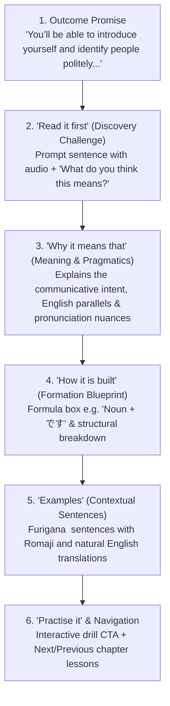
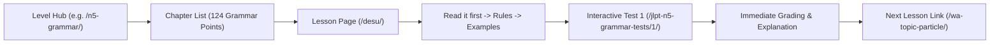
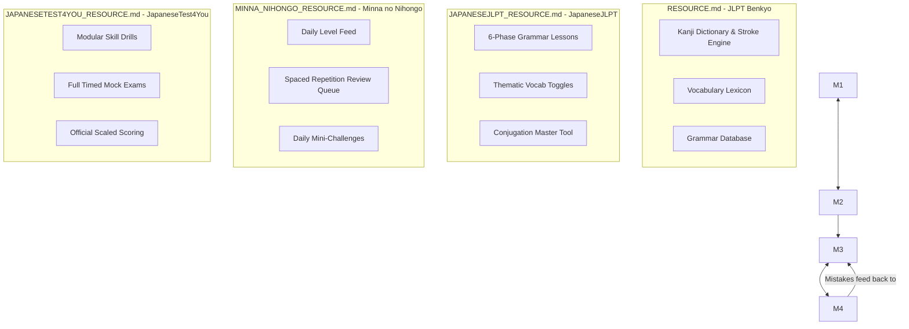

# JapaneseJLPT Website Research & Instructional Systems Specification: Vocabulary, Grammar Lessons, and Sofia.jp Learning Engine Architecture

> **Document Version:** 1.0.0  
> **Target Website Analyzed:** [JapaneseJLPT](https://www.japanesejlpt.com/)  
> **Deliverable Path:** `D:\sofia.jp\JAPANESEJLPT_RESOURCE.md`  
> **Inspection Date:** October 20, 2026  
> **Preserved Prior Research Artifacts:**  
> - [RESOURCE.md](file:///D:/sofia.jp/RESOURCE.md) *(JLPT Benkyo Reverse Engineering & Shared Library Core)*  
> - [MINNA_NIHONGO_RESOURCE.md](file:///D:/sofia.jp/MINNA_NIHONGO_RESOURCE.md) *(Minna no Nihongo Analysis & Level-Based Feed)*  
> - [JAPANESETEST4YOU_RESOURCE.md](file:///D:/sofia.jp/JAPANESETEST4YOU_RESOURCE.md) *(JapaneseTest4You Analysis & JLPT Testing Engine)*  
> **Research Methodology:** REA automated browser inspection (Microsoft Edge), HTTP/2 network analysis, Next.js App Router (RSC) payload reverse engineering, XML sitemap indexing (2,622 URLs), and clean-room instructional systems design.

---

## 1. Research Objective & Inspection Date

### 1.1 Objective
Investigate how **JapaneseJLPT** (`https://www.japanesejlpt.com/`) structures, formats, and sequences its Japanese vocabulary and grammar learning materials. The goal is to reverse-engineer its instructional methodology, UI component hierarchy, and exercise workflows, and translate these findings into an original, modular **Vocabulary & Grammar Learning Subsystem** for Sofia.jp.

### 1.2 Inspection Profile
- **Primary Domain:** `https://www.japanesejlpt.com/`
- **Inspection Date:** October 20, 2026
- **Architecture Profile:** Modern **Next.js (App Router with React Server Components / Turbopack)**, **Tailwind CSS**, **shadcn/ui** component primitives, Lucide icons, Firebase Storage audio CDN, and Cloudflare edge caching (`cf-cache-status: HIT`, `x-nextjs-cache: HIT`).
- **Catalog Breadth:** 2,622 indexed URLs across 13 localized language sub-paths (`/es/`, `/de/`, `/fr/`, `/ko/`, `/th/`, etc.) with 1,077 primary English educational URLs.

---

## 2. Pages Inspected and Source URLs

The following URLs were directly fetched, decompiled, and analyzed:

| Page Category | Inspected URL | Content Profile & Key Attributes |
| :--- | :--- | :--- |
| **Homepage** | `https://www.japanesejlpt.com/` | Portal overview, level cards (N5, N4, N3), learning tools, responsive layout. |
| **XML Sitemap** | `https://www.japanesejlpt.com/sitemap.xml` | 3.8 MB XML registry containing 2,622 URLs categorizing all site sections. |
| **N5 Grammar Path Index** | `https://www.japanesejlpt.com/learn-japanese/n5-grammar/` | 124 grammar points organized into chapters; paginated grid catalog. |
| **N5 Grammar Lesson (Copula)** | `https://www.japanesejlpt.com/learn-japanese/n5-grammar/desu/` | Grammar point: `です` (Polite noun ending); "Read it first" discovery block. |
| **N5 Grammar Lesson (Particle)** | `https://www.japanesejlpt.com/learn-japanese/n5-grammar/wa-topic-particle/` | Grammar point: `は` (Topic particle); formation formulas and usage nuances. |
| **N4 Grammar Lesson (Suffix)** | `https://www.japanesejlpt.com/learn-japanese/n4-grammar/adjective-sa/` | Grammar point: `～さ` (Nominalizing suffix); adjective stem rules. |
| **Vocabulary: Katakana Catalog** | `https://www.japanesejlpt.com/learn-japanese/common-katakana-words/` | 154 common loanwords; interactive visibility toggles; 153 Firebase audio clips. |
| **Vocabulary: Counters Index** | `https://www.japanesejlpt.com/learn-japanese/counters/` | Overview of Japanese counting classifiers and system classification. |
| **Vocabulary: Counter Drill** | `https://www.japanesejlpt.com/learn-japanese/general-counter-tsu/` | Classifier `つ` (1–10 native Japanese numerals, tables, pronunciation audio). |
| **Vocabulary: Verb System** | `https://www.japanesejlpt.com/learn-japanese/verbs/` | Classification of Japanese verbs (Godan, Ichidan, Irregular). |
| **Vocabulary: Verb Conjugator** | `https://www.japanesejlpt.com/learn-japanese/verb-forms/` | Master chart & practice tool for 13 verb forms; 16 tables; 112 audio clips. |
| **Kanji Study Page** | `https://www.japanesejlpt.com/learn-japanese/kanji/一/` | Single character display, stroke order, On/Kun readings, compound vocabulary. |
| **Interactive Grammar Test** | `https://www.japanesejlpt.com/learn-japanese/jlpt-n5-grammar-tests/1/` | 10-question cloze quiz; JSON-LD Schema.org Quiz metadata; instant explanations. |

---

## 3. Vocabulary Organization on JapaneseJLPT

### 3.1 Structural Philosophy: Functional Utility Modules over Dictionary Lists
Unlike traditional JLPT sites (such as JLPT Benkyo) that present vocabulary as an alphabetical or frequency-ordered dictionary of thousands of words, **JapaneseJLPT does not maintain a generic `/vocabulary/` list**. Instead, it organizes vocabulary strictly into **high-utility, morphological thematic modules**:

```
JapaneseJLPT Vocabulary Ecosystem
├── 1. Loanword Catalog (/common-katakana-words/)
│   └── 154 essential daily Katakana words (supermarket, convenience store, etc.)
├── 2. Japanese Classifier/Counter System (/counters/)
│   ├── General Counter (つ · tsu)
│   ├── Small Objects (個 · ko)
│   ├── Flat Objects (枚 · mai)
│   ├── Machines & Vehicles (台 · dai)
│   ├── People (人 · nin)
│   ├── Time & Calendar (時間 · ji, 分 · fun, 日 · nichi)
│   └── Floors (階 · kai)
├── 3. Numerical & Conversion Systems (/numbers/)
│   ├── Native Japanese vs Sino-Japanese numbering
│   ├── Interactive Number Converter Tool
│   └── Spoken Number Listening Drills
├── 4. Verb Morphological Dictionary (/verb-forms/ & /verbs/)
│   ├── 3 Verb Groups (Group 1: Godan / Group 2: Ichidan / Group 3: Irregular)
│   └── 13 Standard Conjugation Paradigms (Te, Ta, Nai, Masu, Potential, Passive, etc.)
└── 5. Kanji-Embedded Vocabulary (/kanji/[char]/)
    └── Words introduced as compound examples under specific Kanji characters.
```

### 3.2 Active Recall Feature: The Column Visibility Toggle
In vocabulary and counter tables, JapaneseJLPT embeds an interactive **"Toggle Visibility"** eye icon (`/icons/hidden.svg`) directly inside the table headers (`English`, `Romaji`, `Katakana`, `Kana`). 
- **Observed Behavior:** Clicking the header icon instantly hides or reveals that entire column's text across all rows.
- **Pedagogical Impact:** Transforms a static reference table into a flashcard-style self-testing drill without reloading the page.

---

## 4. Grammar-Pattern Organization on JapaneseJLPT

### 4.1 Curriculum-Based "Grammar Paths"
JapaneseJLPT abandons random alphabetical grammar sorting in favor of a guided **Curriculum Pathway**:
- **JLPT N5 Grammar Path:** 124 grammar points structured into sequential **Chapters** (e.g., Chapter 1: Basic Declarative Sentences & Identity; Chapter 2: Locations & Existential Predicates).
- **JLPT N4 Grammar Path:** 146 grammar points (complex clauses, giving/receiving verbs, conditionals).
- **JLPT N3 Grammar Path:** 168 grammar points (formal conjunctions, nuances, discourse markers).

### 4.2 Sequential Linear Linking
Every grammar point page features explicit bidirectional navigation:
- `← Previous: です Polite ending for basic noun statements`
- `Next →: か Turns a sentence into a question`
This encourages learners to follow a coherent pedagogical ladder rather than jumping randomly between unrelated particles and conjugations.

---

## 5. Vocabulary Lesson Structure

Analyzing `jj_katakana_words.html` and `jj_counter_tsu.html` reveals how individual vocabulary categories are taught:

```
┌─────────────────────────────────────────────────────────────────┐
│ 1. Header & Functional Introduction                             │
│    - Title (e.g., "General Counter つ")                         │
│    - Practical explanation of when to use this counter vs others│
├─────────────────────────────────────────────────────────────────┤
│ 2. Interactive Study Table (shadcn/ui Table)                    │
│    ┌─────────┬───────────────┬──────────────┬────────────────┐  │
│    │ Audio 🔊│ English 👁️   │ Romaji 👁️   │ Japanese 👁️   │  │
│    ├─────────┼───────────────┼──────────────┼────────────────┤  │
│    │  [▶]    │ one thing     │ hitotsu      │ 一つ (ひとつ)  │  │
│    │  [▶]    │ two things    │ futatsu      │ 二つ (ふたつ)  │  │
│    └─────────┴───────────────┴──────────────┴────────────────┘  │
├─────────────────────────────────────────────────────────────────┤
│ 3. Cultural & Linguistic Nuance Callout                         │
│    - "How do you count beyond ten?" (Transition from つ to 番)  │
│    - Irregular phonological shifts (rendaku, geminate sokuon)   │
├─────────────────────────────────────────────────────────────────┤
│ 4. Related Posts & Next Steps Grid                              │
│    - Small and Round Objects (個 · ko)                          │
│    - Days of the Month (日 · nichi)                             │
└─────────────────────────────────────────────────────────────────┘
```

---

## 6. Grammar Lesson Structure: The 6-Phase Instructional Sequence

Every individual grammar lesson on JapaneseJLPT adheres strictly to a predictable, research-backed 6-phase pedagogical flow:



### 6.1 Phase Breakdown
1. **The Outcome Promise:** Immediately tells the learner what communicative superpower they will unlock (e.g., *"You’ll be able to mark the topic of a sentence so listeners know what you’re talking about"*).
2. **"Read It First" (Guided Discovery):** Before presenting abstract grammar terminology, the learner is challenged with an authentic Japanese sentence using Furigana `<ruby>` and Romaji, followed by a revealable answer toggle.
3. **"Why It Means That" (Linguistic Explanation):** Demystifies the grammar logic without overwhelming jargon, highlighting speech register and phonetic nuances (e.g., noting that the `u` in `desu` is devoiced, sounding like *"dess"*).
4. **"How It Is Built" (Formation Equation):** Employs visual structural formulas (e.g., `Topic + は + Information about the topic`).
5. **Contextual Examples:** Real-world sentences demonstrating different sentence subjects, common collocations, and daily social situations.
6. **Next Step Action:** Clear prompts directing learners to test themselves in the interactive quiz or proceed to the next logical concept in the syllabus.

---

## 7. Observed Teaching Methods: Comparative Analysis

| Method Dimension | JapaneseJLPT (Observed) | Traditional Textbook (e.g. Genki) | Sofia.jp Planned Platform |
| :--- | :--- | :--- | :--- |
| **Discovery Model** | **Inductive** ("Read it first" sentence before rules) | Deductive (Rules and charts first, then drills) | **Hybrid Inductive-Deductive** with interactive breakdown |
| **Phonetics & Audio** | Native audio buttons next to key vocabulary and sentences | External CD / separate audio app | Embedded Web Audio API with synchronized word highlighting |
| **Active Recall** | Column hide/reveal toggles; revealable sentence translations | Passive reading | Integrated interactive flashcards and SM-2 spaced repetition |
| **Contextual Nuance** | Notes natural pronunciation (e.g. devoicing) and informal omissions | Often presents strictly formal artificial dialogue | Real-world usage notes, register flags (Formal / Colloquial), and slang alerts |

---

## 8. UI Layout and Components

### 8.1 Technology & Styling
- **CSS Architecture:** Tailwind CSS utility classes paired with shadcn/ui React components (`Table`, `Card`, `Button`, `Breadcrumb`).
- **Typography Stack:** Clean sans-serif Japanese system fonts: `"Hiragino Kaku Gothic ProN"`, `"Yu Gothic"`, `"Meiryo"`, sans-serif.
- **Color Palette:**
  - Backgrounds: Clean crisp whites (`bg-white`) and subtle slate borders (`border-slate-200/80`).
  - Dark Mode: Full dark theme support via Tailwind `dark:bg-slate-900` and `dark:border-slate-800`.
  - Brand Accent: Warm Japanese vermilion/red (`text-red-700`, `hover:border-red-200`, `dark:text-red-400`).

### 8.2 Component Anatomy
1. **Breadcrumb Ribbon:** Semantic navigation trails at the top of every page (`Home / JLPT / JLPT N5 Grammar List / Polite ending...`).
2. **Grammar Formula Pill / Callout Box:** Distinct light gray/blue container highlighting the structural rule (`Noun + です`).
3. **Interactive Audio Button:** Compact inline circular button (`lucide-volume-2` or `▶`) triggering audio playback without disrupting the visual reading rhythm.
4. **Interactive Quiz Card:** Form container featuring numbered questions, inline furigana prompts, radio/button choice grids, and an instant explanation accordion.

---

## 9. Example Sentence and Translation Presentation

### 9.1 W3C Semantic `<ruby>` Formatting
JapaneseJLPT authors all Japanese sentences using semantic HTML5 `<ruby>` tags:
```html
<ruby>蓮<rt>れん</rt></ruby>は<ruby>学生<rt>がくせい</rt></ruby>です。
```
- **Accessibility:** Screen readers correctly prioritize the base Kanji while reading aloud the `<rt>` phonetic gloss.
- **Styling:** Furigana text is rendered at roughly 50% font size directly centered over the kanji character.

### 9.2 Three-Tier Bilingual Display
Every example sentence is displayed in a clear, consistent 3-tier hierarchy:
```
[Tier 1 - Japanese]:  今日 (きょう) は 月曜日 (げつようび) です。 [▶ Audio]
[Tier 2 - Romaji]:    kyou wa getsuyoubi desu.
[Tier 3 - English]:   Today is Monday.
```

---

## 10. Navigation and User Flow



---

## 11. Exercises and Review Functionality

### 11.1 Observed Interactive Test Format (`/jlpt-n5-grammar-tests/1/`)
- **Structure:** 10 questions per test.
- **Input Style:** Clickable option buttons for cloze/fill-in-the-blank items.
- **Submission:** Single "Submit" action at the bottom of the test.
- **Feedback & Explanation:**
  - Upon submission, the engine reveals the correct answer and a dedicated **Explanation Box**.
  - Includes a detailed pedagogical justification and a **Usage formula box** (e.g., `[Verb stem] + ませんか`).

### 11.2 Observed Limitations of JapaneseJLPT's Exercise System
- **No Mistake Persistence:** Missed questions are not saved to an account; refreshing the page resets the score.
- **No Sentence Ordering Exercises:** Lacks the official JLPT Star (`★`) questions.
- **No Audio in Grammar Tests:** Tests are purely text cloze drills without listening integration.

---

## 12. Desktop and Mobile Presentation

- **Desktop (1280px+):** Centered readable reading container (`max-w-4xl`), spacious line height (`leading-relaxed`), side-by-side table layouts.
- **Mobile (< 640px):** Single-column vertical stacking, responsive horizontal scrolling for wide conjugation tables (`overflow-x-auto`), large touch targets (minimum 44x44px for buttons).

---

## 13. Screenshots and Evidence References

| Evidence ID | Target Page / Element | Direct Observation Details |
| :--- | :--- | :--- |
| `EVID-JJ-01` | `https://www.japanesejlpt.com/` | Verified Next.js App Router headers: `x-powered-by: Next.js`, `vary: rsc`. |
| `EVID-JJ-02` | `https://www.japanesejlpt.com/sitemap.xml` | Extracted 2,622 URLs; verified absence of a generic `/vocabulary/` directory. |
| `EVID-JJ-03` | `/learn-japanese/n5-grammar/desu/` | Verified 6-phase teaching structure; confirmed 7 semantic `<ruby>` tags. |
| `EVID-JJ-04` | `/learn-japanese/common-katakana-words/` | Verified 154 table rows; confirmed Firebase Storage audio CDN integration. |
| `EVID-JJ-05` | `/learn-japanese/verb-forms/` | Verified 16 conjugation tables, 13 verb forms, and 112 audio playback triggers. |
| `EVID-JJ-06` | `/learn-japanese/jlpt-n5-grammar-tests/1/` | Verified Schema.org `Quiz` microdata with 10 question cloze items and explanations. |

---

## 14. Observed versus Inferred Features

| Feature | Classification | Factual Status / Verification Notes |
| :--- | :--- | :--- |
| **Next.js & React Server Components** | **Observed** | Confirmed via `x-powered-by: Next.js` and RSC payload streams in HTML source. |
| **Tailwind CSS & shadcn/ui** | **Observed** | Exact class conventions (`text-muted-foreground`, `data-[state=selected]`) match shadcn/ui. |
| **Audio via Firebase Storage** | **Observed** | Audio tags reference `https://firebasestorage.googleapis.com/v0/b/...`. |
| **Column Visibility Toggles** | **Observed** | Interactive eye icons in Katakana and Counter tables hide English, Romaji, or Japanese. |
| **User Progress / Cloud Sync** | **Inferred (Absent)** | No login form, authentication cookies, or user profile endpoints observed. |
| **Native Mobile App Integration** | **Observed** | App Store banner meta tag: `app-id=1519672644` (JapaneseJLPT iOS companion app). |

---

## 15. Proposed Sofia.jp Vocabulary Learning Interface

Sofia.jp will build a unified Vocabulary Module that merges the structured reference power of JLPT Benkyo with the active-recall tools observed on JapaneseJLPT.

### 15.1 Vocabulary Browser Specifications
- **Level Tabs:** Switcher for N5, N4, N3, N2, N1.
- **Multi-Field Search:** Real-time search across Kanji, Hiragana/Katakana, Romaji, and English gloss.
- **Thematic Categories:** Fast filters for *Loanwords (Katakana)*, *Counters*, *Verbs by Group*, *Adjectives*, and *Common Colloquialisms*.
- **Interactive Flashcard Mode:** Includes JapaneseJLPT's column hide/reveal toggle (allowing learners to hide English or Kana with one click).

### 15.2 Vocabulary Detail Page Layout
- **Hero Card:** Large Kanji heading with toggleable Furigana, pitch accent notation, and native audio button.
- **Grammar Tags:** Part of speech, JLPT level, transitivity/intransitivity indicator (`自動詞 / 他動詞`).
- **Meaning & Synonyms:** English definitions, nuance notes, and JLPT Benkyo-style related terms.
- **Live Example Sentences:** 3–5 bilingual sentences with word-by-word hover tooltips.
- **Action Toolbar:** "Add to Spaced Repetition", "Practice Conjugation", and "View Related Grammar Points".

---

## 16. Proposed Sofia.jp Grammar Learning Interface

Adopting JapaneseJLPT's 6-phase sequence, Sofia.jp's grammar lesson interface will feature:

```
┌────────────────────────────────────────────────────────────────────────┐
│ 1. HERO HEADER                                                         │
│    [N5 Grammar · Chapter 1]                                            │
│    H1: です (desu) — Polite Copula                                     │
│    Promise: "Introduce yourself and identify people politely."         │
├────────────────────────────────────────────────────────────────────────┤
│ 2. READ IT FIRST (Discovery Challenge)                                 │
│    Prompt: 蓮 (れん) は 学生 (がくせい) です。 [🔊 Audio]               │
│    [ What does this sentence mean? ▼ Click to reveal ]                 │
├────────────────────────────────────────────────────────────────────────┤
│ 3. FORMATION BLUEPRINT                                                 │
│    ┌──────────────────────────────────────────────────────────┐        │
│    │  [Noun] + です  (Example: 学生 + です = 学生です)        │        │
│    └──────────────────────────────────────────────────────────┘        │
│    Conjugation Rule Matrix: Present / Past / Negative / Past-Negative  │
├────────────────────────────────────────────────────────────────────────┤
│ 4. DEEP-DIVE USAGE NOTES                                               │
│    - When to use vs だ (informal)                                      │
│    - Pronunciation note: Devoicing the final 'u'                       │
│    - Common mistake: Overusing subject pronouns                        │
├────────────────────────────────────────────────────────────────────────┤
│ 5. BILINGUAL EXAMPLES WITH INTERACTIVE WORD BREAKDOWN                  │
│    - Sentence 1: エマです。 [🔊] (I am Emma)                          │
│    - Sentence 2: 先生です。 [🔊] (I am a teacher)                      │
│    [Toggle Furigana: ON | HOVER | OFF]                                 │
├────────────────────────────────────────────────────────────────────────┤
│ 6. QUICK-CHECK PRACTICE WIDGET                                         │
│    Question: "I am a doctor" -> 私は医者 _______。                    │
│    [1: です] [2: あります] [3: します] [4: だ]                         │
│    Instant Feedback + SM-2 Mistake Queue integration                   │
└────────────────────────────────────────────────────────────────────────┘
```

---

## 17. Shared Learning-Data Model (Relational SQLite DDL)

To ensure that Vocabulary, Kanji, Grammar, and Example Sentences are reused throughout the application without duplication, Sofia.jp uses the following relational schema:

```sql
-- ====================================================================
-- SOFIA.JP SHARED VOCABULARY & GRAMMAR LEARNING ENGINE SCHEMA
-- ====================================================================

PRAGMA foreign_keys = ON;

-- --------------------------------------------------------------------
-- 1. VOCABULARY CORE
-- --------------------------------------------------------------------
CREATE TABLE IF NOT EXISTS vocabulary_items (
    id TEXT PRIMARY KEY,                       -- e.g. 'v_n5_gakusei'
    written_form TEXT NOT NULL,                -- e.g. '学生'
    reading_kana TEXT NOT NULL,                -- e.g. 'がくせい'
    romaji TEXT NOT NULL,                      -- e.g. 'gakusei'
    english_meaning TEXT NOT NULL,             -- e.g. 'student'
    part_of_speech TEXT NOT NULL,              -- 'noun', 'godan_verb', 'ichidan_verb', 'i_adj', etc.
    jlpt_level TEXT NOT NULL CHECK(jlpt_level IN ('N5', 'N4', 'N3', 'N2', 'N1')),
    pitch_accent TEXT,                         -- e.g. '0' (heiban)
    audio_url TEXT,
    created_at DATETIME DEFAULT CURRENT_TIMESTAMP
);

-- --------------------------------------------------------------------
-- 2. GRAMMAR RULES & FORMATION
-- --------------------------------------------------------------------
CREATE TABLE IF NOT EXISTS grammar_lessons (
    id TEXT PRIMARY KEY,                       -- e.g. 'g_n5_desu'
    pattern_title TEXT NOT NULL,               -- e.g. 'です'
    english_summary TEXT NOT NULL,             -- e.g. 'Polite ending for basic noun statements'
    outcome_promise TEXT NOT NULL,             -- Communicative objective
    jlpt_level TEXT NOT NULL CHECK(jlpt_level IN ('N5', 'N4', 'N3', 'N2', 'N1')),
    chapter_number INTEGER NOT NULL,           -- Progression sequence (1, 2, 3...)
    lesson_order INTEGER NOT NULL,             -- Sequence within chapter
    discovery_sentence_jp TEXT NOT NULL,       -- "Read it first" sentence
    discovery_sentence_en TEXT NOT NULL,       -- Revealable translation
    formation_formula TEXT NOT NULL,           -- e.g. 'Noun + です'
    usage_notes_markdown TEXT NOT NULL,        -- Nuance, exceptions, pronunciation
    common_mistakes_markdown TEXT,             -- Typical learner errors
    created_at DATETIME DEFAULT CURRENT_TIMESTAMP
);

-- --------------------------------------------------------------------
-- 3. EXAMPLE SENTENCES (Reused by Vocab, Kanji, and Grammar)
-- --------------------------------------------------------------------
CREATE TABLE IF NOT EXISTS example_sentences (
    id TEXT PRIMARY KEY,                       -- e.g. 'ex_00109'
    sentence_japanese_html TEXT NOT NULL,      -- Full sentence with <ruby> tags
    sentence_romaji TEXT NOT NULL,
    sentence_english TEXT NOT NULL,
    audio_url TEXT,
    created_at DATETIME DEFAULT CURRENT_TIMESTAMP
);

-- Many-to-Many: Grammar to Examples
CREATE TABLE IF NOT EXISTS grammar_example_links (
    grammar_id TEXT NOT NULL,
    example_id TEXT NOT NULL,
    display_order INTEGER NOT NULL DEFAULT 1,
    PRIMARY KEY (grammar_id, example_id),
    FOREIGN KEY (grammar_id) REFERENCES grammar_lessons(id) ON DELETE CASCADE,
    FOREIGN KEY (example_id) REFERENCES example_sentences(id) ON DELETE CASCADE
);

-- Many-to-Many: Vocabulary to Examples
CREATE TABLE IF NOT EXISTS vocab_example_links (
    vocab_id TEXT NOT NULL,
    example_id TEXT NOT NULL,
    PRIMARY KEY (vocab_id, example_id),
    FOREIGN KEY (vocab_id) REFERENCES vocabulary_items(id) ON DELETE CASCADE,
    FOREIGN KEY (example_id) REFERENCES example_sentences(id) ON DELETE CASCADE
);

-- --------------------------------------------------------------------
-- 4. LEARNER PROGRESS & SPACED REPETITION (SM-2)
-- --------------------------------------------------------------------
CREATE TABLE IF NOT EXISTS user_lesson_progress (
    user_id TEXT NOT NULL,
    item_type TEXT NOT NULL CHECK(item_type IN ('vocabulary', 'grammar')),
    item_id TEXT NOT NULL,
    mastery_status TEXT NOT NULL DEFAULT 'learning' CHECK(mastery_status IN ('new', 'learning', 'reviewing', 'mastered')),
    repetition_count INTEGER NOT NULL DEFAULT 0,
    easiness_factor REAL NOT NULL DEFAULT 2.5,
    interval_days INTEGER NOT NULL DEFAULT 1,
    next_review_due DATE NOT NULL,
    last_reviewed_at DATETIME,
    PRIMARY KEY (user_id, item_type, item_id)
);

CREATE INDEX IF NOT EXISTS idx_grammar_level_order ON grammar_lessons(jlpt_level, chapter_number, lesson_order);
CREATE INDEX IF NOT EXISTS idx_user_reviews ON user_lesson_progress(user_id, next_review_due, mastery_status);
```

---

## 18. Practice and Spaced-Repetition Recommendations

### 18.1 Lesson-Integrated Quick Checks
Each grammar lesson terminates with an interactive 3-question **Quick Check**:
1. Question 1: Fill in the blank (evaluating formation).
2. Question 2: Error identification (catching common misconceptions).
3. Question 3: Meaning selection (evaluating contextual nuance).

### 18.2 Spaced Repetition Scheduling
When an answer is entered:
- Correct answers increase the SM-2 interval ($I_{n} = I_{n-1} \times EF$).
- Incorrect answers reset the interval to 1 day and immediately enqueue the item in the learner's **Daily Review Feed** (researched in `MINNA_NIHONGO_RESOURCE.md`).

---

## 19. Integration With Other Sofia.jp Modules

Sofia.jp links its four researched modules into an interconnected Japanese learning platform:



1. **Lesson -> Lexicon:** Every vocabulary word appearing in a grammar sentence links to its full dictionary entry from `RESOURCE.md`.
2. **Test -> Lesson:** Missing a question in the Mock Exam Simulator (`JAPANESETEST4YOU_RESOURCE.md`) directly recommends the corresponding JapaneseJLPT-style grammar lesson.
3. **Feed -> Spaced Review:** Missed grammar points surface automatically in the daily Minna no Nihongo-style review feed.

---

## 20. Original Sample Lesson & Exercise Formats

### 20.1 Clean-Room Grammar Lesson: N5 Adjective Predicate (`〜いです`)
- **Title:** `〜い (i-adjectives) — Describing Qualities and States`
- **JLPT Level:** N5 | **Chapter:** 2
- **Outcome Promise:** *"You will be able to describe things, weather, and physical sensations politely using i-adjectives."*
- **Read It First:**
  - Sentence: `<ruby>今日<rt>きょう</rt></ruby>は<ruby>本当<rt>ほんとう</rt></ruby>に<ruby>暑<rt>あつ</rt></ruby>いです。`
  - Audio: `kyou wa hontou ni atsui desu.`
  - Prompt: *"What does this sentence mean?"* -> *Answer: "It is really hot today."*
- **Formation Formula:** `[i-Adjective] + です`
- **Bilingual Examples:**
  1. `このお茶はとても熱いです。` (This tea is very hot.)
  2. `日本の夏は暑いです。` (Summer in Japan is hot.)
- **Quick Check Question:**
  - *"Which is the polite non-past form of 高い (takai)?"*
  - Options: `1. 高いです` (Correct) | `2. 高いだ` | `3. 高いでした` | `4. 高くです`

---

## 21. Features to Implement First

1. **Next.js/React Furigana Engine Component:** `<FuriganaText text="..." furiganaMap="..." mode="always|hover|off" />`.
2. **Vocabulary Active-Recall Table:** Interactive column visibility toggle (`ToggleVisibilityTable.tsx`) for katakana and counters.
3. **6-Phase Grammar Lesson Template:** Reusable page layout component implementing the Discovery -> Rule -> Example flow.
4. **Relational Database Migrations:** SQLite schema linking `vocabulary_items`, `grammar_lessons`, and `example_sentences`.

---

## 22. Features Requiring Further Research

1. **Pitch Accent Visualization:** Adding Tokyo-standard pitch contour bars (heiban, atamadaka, nakadaka, odaka) above vocabulary words.
2. **Audio Generation Pipeline:** Evaluating OpenAI TTS vs ElevenLabs for natural, native-speed Japanese voiceovers with furigana timing data.
3. **Speech Recognition (Pronunciation Check):** Web Speech API integration allowing learners to read aloud and check their pronunciation against example sentences.

---

## 23. Copyright, Licensing, and Attribution Considerations

- **Strict Clean-Room Policy:** No text, audio recordings, or question sets were copied from `japanesejlpt.com`.
- **Open Educational Data:** Base dictionary data will source from the open-source **JMdict/EDICT** and **KANJIDIC2** project (Monash University / Electronic Dictionary Research and Development Group), licensed under Creative Commons Attribution-ShareAlike.
- **Original Content Authorship:** All grammar explanations, outcome promises, and example sentences created for Sofia.jp will be original educational content.

---

## 24. Technical Recommendations and Next Steps

### 24.1 Tech Stack Alignment
- **Frontend:** React 18 with Vite, TypeScript, Tailwind CSS, Lucide-React icons, and Zustand for local state management.
- **Backend:** Python 3.11 with FastAPI, Pydantic v2 validation models, and SQLite (via SQLAlchemy or aiosqlite).
- **Deployment:** Static asset CDN caching for audio and font files.

### 24.2 Immediate Next Steps for the Development Team
1. Create database migration script `001_initial_schema.sql` implementing the unified schema from Section 17.
2. Develop `FuriganaText.tsx` and `LessonContainer.tsx` in `src/components/lessons/`.
3. Seed the initial 10 N5 grammar lessons and 50 essential vocabulary words using clean-room JSON fixtures.
