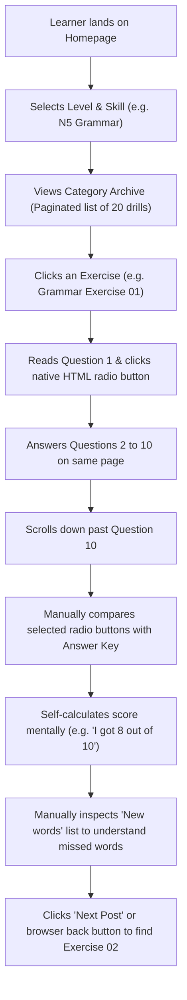
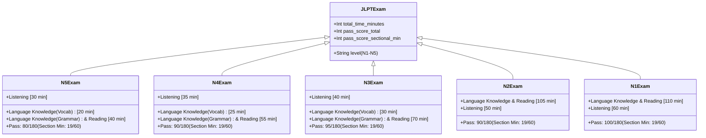
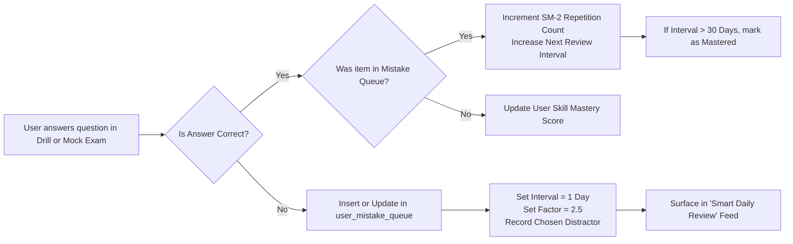

# JLPT Testing Engine Research & System Specification: JapaneseTest4You Reverse Engineering & Sofia.jp Test Platform Design

> **Document Version:** 1.0.0  
> **Target Analyzed:** [JapaneseTest4You](https://japanesetest4you.com/)  
> **Output Deliverable:** `D:\sofia.jp\JAPANESETEST4YOU_RESOURCE.md`  
> **Associated Project Files:**  
> - [RESOURCE.md](file:///D:/sofia.jp/RESOURCE.md) *(JLPT Benkyo Analysis & Shared Library Core)*  
> - [MINNA_NIHONGO_RESOURCE.md](file:///D:/sofia.jp/MINNA_NIHONGO_RESOURCE.md) *(Minna no Nihongo Analysis & Level-Based Feed)*  
> **Methodology:** REA (Reverse Engineer Anything) automated browser instrumentation (Microsoft Edge), HTTP/2 network inspection, DOM hierarchy parsing, WordPress REST endpoint profiling, and clean-room instructional systems design.

---

## 1. Executive Summary & Research Methodology

JapaneseTest4You (`japanesetest4you.com`) is one of the longest-standing free online study portals for the Japanese Language Proficiency Test (JLPT). Over more than a decade, it has aggregated hundreds of modular practice drills spanning levels N5 through N1 across five major competency tracks: **Grammar**, **Vocabulary**, **Kanji**, **Reading**, and **Listening**.

### Research Findings Summary
1. **Content Architecture:** JapaneseTest4You is architected as an archival content catalog built atop WordPress. Rather than a dynamic web application with a unified testing engine, each test is published as an individual, static blog post containing between 5 and 10 questions.
2. **Input & Interaction Model:** Questions are laid out in standard HTML paragraphs with unstyled native `<input type="radio">` elements. Crucially, there are **no enclosing `<form>` tags, no client-side JavaScript evaluators, and no server-side submission endpoints**. 
3. **Evaluation & Feedback:** There is **no automated scoring, no timing, no progress tracking, and no session persistence**. Users self-evaluate by scrolling past the questions to a static **"Answer Key"** located on the same page, where correct answers are listed with target text highlighted using red underlines (`<mark>` and `<span>`).
4. **Pedagogical Gaps:**
   - Learners are exposed to answers accidentally while scrolling, spoiling the testing effect.
   - No diagnostic feedback explains *why* a distractor is incorrect.
   - Questions are isolated; missed items are not queued for spaced repetition or linked to underlying grammar rules or vocabulary flashcards.
   - High-value official JLPT formats—notably **Sentence Ordering (文の組み立て / `___ ___ ★ ___`)** and **Text Grammar (文章の文法)**—are entirely absent from the drill catalog.

### Mission for Sofia.jp
Using these findings as competitive intelligence, Sofia.jp will design and implement a **state-of-the-art JLPT Test Engine** that combines:
- **Clean-room original questions** across all 5 JLPT levels (N5–N1) adhering precisely to official Japanese Educational Exchanges and Services (JEES) test specifications.
- **Dual-Mode Execution:**
  - **Practice Mode:** Immediate per-question validation, furigana toggle, audio playback speed control, interactive word breakdowns, and comprehensive pedagogical explanations.
  - **Full Mock-Test Mode:** Strict exam timers, JLPT-standard section pagination (Language Knowledge, Reading, Listening), score scaling (0–180 scale), and sectional minimum pass/fail thresholds.
- **Deep Relational Integration:** Direct foreign-key links from test questions to Sofia.jp's core Vocabulary, Kanji, and Grammar libraries.
- **Smart Mistake Tracking:** An automated Leitner/SM-2 spaced repetition queue that isolates erroneous responses and generates targeted remedial drills.

---

## 2. Target Website Analysis: JapaneseTest4You Overview & Technical Stack

### 2.1 Technology Stack Profile
Direct network, header, and DOM analysis of `https://japanesetest4you.com/` revealed the following infrastructure:

| Component | Target Implementation | Analysis & Limitations |
| :--- | :--- | :--- |
| **CMS Platform** | WordPress (custom classic theme, `theme-options-header`) | Traditional multi-category blog layout. Content authored in classic/Gutenberg post editor. |
| **Hosting & CDN** | Cloudflare APO (Automatic Platform Optimization), Nginx reverse proxy | Cloudflare bot management active; static assets and pages cached aggressively with `cf-cache-status: HIT`. |
| **Quiz Engine** | **None** (Plain HTML radio inputs) | Zero specialized quiz plugins (e.g., Watu, LearnDash, WP-Pro-Quiz, or H5P). All quiz logic is purely visual layout. |
| **State Persistence** | **None** | No `localStorage`, `sessionStorage`, or IndexedDB usage for test sessions. Refreshing the browser resets all radios. |
| **Audio Delivery** | Native HTML5 `<audio controls src="...">` | MP3 files hosted statically under `/choukai/0002/n5_X_X.mp3`. Single playhead, no playback rate manipulation, no synchronized transcripts. |
| **Video Delivery** | Embedded YouTube `<iframe>` | YouTube embeds pointing to channel lessons (e.g., *JLPT N5 Kanji Lesson #1: 人*), primarily used as promotional conversion funnels for Patreon. |
| **Offline Export** | Direct static PDF links | Static PDF worksheets uploaded to `/offlinetest/*.pdf` (e.g., `N5G1-yn5mf.pdf`) allowing users to print questions. |

### 2.2 Observation Verification Matrix
To ensure analytical integrity, every finding is categorized strictly according to empirical observation:

| Feature / Behavior | Observed Status | Evidence / Notes |
| :--- | :--- | :--- |
| **Level Separation (N5–N1)** | **Directly Observed** | Homepage and primary navigation menus explicitly segment categories: `/category/jlpt-n5/` through `/category/jlpt-n1/`. |
| **Skill Tracks** | **Directly Observed** | Grammar, Kanji, Vocabulary, Reading, and Listening have discrete category archives for every level. |
| **Test Granularity** | **Directly Observed** | Numbered post drills: e.g., `JLPT N5 – Grammar Exercise 01` to `Exercise 20`; `JLPT N1 – Grammar Exercise 01` to `Exercise 26`. |
| **Question Display** | **Directly Observed** | Single vertical list of 5–10 questions per post. Standard paragraph tags with `<input type="radio">`. |
| **Evaluation Mechanism** | **Directly Observed** | Purely manual. Static text section labeled `Answer Key:` located at the bottom of the entry content. |
| **Explanations** | **Directly Observed** | Minimal. Consists solely of repeating the sentence with the correct choice underlined in red, followed by a raw "New words" vocabulary glossary. |
| **Sentence Ordering (`★`)** | **Directly Observed (Absent)** | Keyword searches for `★`, `星`, and `並べ替え` across hundreds of drills returned zero hits. |
| **Mock Test Simulator** | **Directly Observed (Absent)** | No integrated full mock tests, timers, or section transitions exist on the platform. |
| **User Accounts / Progress** | **Directly Observed (Absent)** | No login system for learners; no persistent dashboard or mistake history. |

---

## 3. Website Information Architecture & Hierarchy

```
japanesetest4you.com
├── Navigation Menus (Home | Ebooks | Flashcards | F.A.Q | About | Donate)
├── JLPT N5
│   ├── Grammar Tests (20 drills; 10 questions/drill)
│   ├── Kanji Tests (19 drills; 10 questions/drill)
│   ├── Vocabulary Tests (20 drills; 10 questions/drill)
│   ├── Reading Tests (14 drills; 5 passages/drill)
│   └── Listening Tests (20 drills; 5 audio items/drill)
├── JLPT N4 (Grammar, Kanji, Vocabulary, Reading, Listening)
├── JLPT N3 (Grammar, Kanji, Vocabulary, Reading, Listening)
├── JLPT N2 (Grammar, Kanji, Vocabulary, Reading, Listening)
├── JLPT N1
│   ├── Grammar Tests (26 drills; 10 questions/drill)
│   ├── Kanji Tests (15+ drills; 10 questions/drill)
│   ├── Vocabulary Tests (20+ drills; 10 questions/drill)
│   ├── Reading Tests (49+ drills; 5 passages/drill)
│   └── Listening Tests (15+ drills; 5 audio items/drill)
└── Auxiliary Learning
    ├── Vocabulary Lists (Static HTML vocabulary reference tables)
    ├── Grammar Lists (Static grammar points with example sentences)
    ├── Flashcards (/flashcard/ – individual posts with bilingual sentences & Anki download links)
    └── Commercial E-Books (Downloadable PDFs monetized via Gumroad / Patreon)
```

### 3.1 Content Presentation Patterns
Each drill page conforms to an identical vertical content structure:
1. **Post Header:** Exercise Title (`JLPT N5 – Grammar Exercise 01`), publication date, and category breadcrumb tag.
2. **Question Body:**
   - Item numbering (1 through 10).
   - Problem prompt in Japanese (plain Kanji and Kana; **no `<ruby>` furigana tags**).
   - Four `<input type="radio">` options placed on individual lines separated by `<br>`.
3. **The Separator & Answer Key:**
   - `<p><strong>Answer Key:</strong></p>`
   - Completed sentences with the correct answer injected into the blank and highlighted: `<mark style="background-color:rgba(0, 0, 0, 0)" class="has-inline-color has-vivid-red-color"><span style="text-decoration: underline;">selected_option</span></mark>`.
4. **Embedded Multimedia & Sponsorship:**
   - YouTube video embed of a related Kanji lesson.
   - Patreon call-to-action banner promoting downloadable video transcripts and audio bundles.
5. **Contextual Vocabulary Glossary ("New words"):**
   - A list of words appearing in the test items with Kanji, Romaji transliteration, and English gloss:
     - `毎日 (mainichi): every day`
     - `新聞 (shinbun): newspaper`
     - `読む (yomu): to read`
6. **Offline Asset Link:** Static link to an offline PDF worksheet.
7. **Social & Sharing Widgets:** Standard Facebook and Twitter share buttons.

---

## 4. Analysis of the Test-Taking Experience: Workflow & Shortcomings

### 4.1 Step-by-Step Learner Journey on JapaneseTest4You



### 4.2 Usability & Instructional Deficiencies
1. **Accidental Answer Spoilage:** Because the Answer Key is rendered directly beneath Question 10 in standard flow, any learner scrolling on a mobile device or smaller laptop screen inevitably glimpses the answers to Questions 8, 9, and 10 before completing them.
2. **Absence of Immediate Diagnostic Feedback:** A learner who selects an incorrect distractor receives no explanation as to *why* that choice was wrong or what grammatical misconception it represents.
3. **Radio Button State Volatility:** Because standard HTML radio buttons are not tied to any form handler or cookie/local storage, accidental page reloads, tab switches on mobile browsers, or back-navigation wipe out all entered answers.
4. **Lack of Spaced Repetition Loop:** If a student fails a difficult grammar question involving causative-passive verbs (`〜させられる`), that item disappears as soon as they navigate away. The platform provides no mechanism to bookmark, star, or re-test failed items.
5. **No Timed Exam Pressure:** Official JLPT exams require strict time management (e.g., N1 Language Knowledge & Reading gives 110 minutes for ~70 complex questions). Practicing without an active pacing clock fails to build essential test-taking stamina.

---

## 5. Comprehensive Analysis of Observed Question Formats

JapaneseTest4You focuses on multiple-choice formats with four distractors. Below is the technical breakdown of each observed question category.

### 5.1 Format A: Grammar Fill-in-the-Blank (Sentence Grammar 1 / 文法形式の判断)
- **Observed Structure:** A single Japanese sentence containing a blank placeholder `_______` testing particles, verb conjugations, compound auxiliaries, or formal honorifics.
- **Observed Distractors:** 4 options exhibiting subtle morphological variations:
  - *Example Pattern:* Particle selection (`へ`, `を`, `に`, `が`).
  - *Example Pattern:* Verb auxiliary conjugation (`行く`, `行って`, `行った`, `行っている`).
  - *Example Pattern:* Adjective inflection (`長ってすぎます`, `長くすぎます`, `長いすぎます`, `長すぎます`).
- **Answer Presentation:** The sentence is reprinted with the correct answer substituted into the blank in underlined red font.

### 5.2 Format B: Kanji Reading & Orthography (漢字読み・表記)
- **Observed Structure:** A full contextual sentence with target kanji compound underlined or surrounded by whitespace. The item then isolates the target compound and provides 4 hiragana options.
- **Observed Distractors:** Phonological traps including:
  - Voiced vs. unvoiced consonants (`てんき` vs `でんき`).
  - Long vs. short vowels (`くじ` vs `くうじ` vs `きゅうじ`).
  - On'yomi vs. Kun'yomi confusion (`らいげつ` vs `らいがつ` vs `くがつ`).
- **Answer Presentation:** Direct mapping format: `Question 1: 4 (来月: らいげつ)`.

### 5.3 Format C: Contextual Vocabulary Selection (文脈規定)
- **Observed Structure:** Sentences requiring semantic and situational precision.
- **Observed Distractors:** Words sharing the same grammatical part of speech (e.g., four transitive verbs or four temporal adverbs) where only one fits the pragmatic context.
  - *Observed Items:* Clothing verbs (`きて`, `しめて`, `はいって`, `かぶって` for hats/ぼうし); Counter suffixes (`にだい`, `にさつ`, `にほん`, `にまい` for bicycles/じてんしゃ).

### 5.4 Format D: Reading Comprehension (読解 - 短文・中文)
- **Observed Structure:**
  - A Japanese text passage (ranging from 100 characters in N5 up to 600+ characters in N1).
  - Followed by 1 to 3 comprehension questions testing author intent, causal relationships, or passage main ideas.
- **Observed Visuals:** Occasionally accompanied by simple illustrations or authentic informational artifacts (e.g., notice board flyers, coupons).
- **Answer Presentation:** Question restated with the correct choice text verbatim.

### 5.5 Format E: Listening Comprehension (聴解 - 課題理解)
- **Observed Structure:**
  - An embedded HTML5 audio element `<audio controls src="...">`.
  - A prompt diagram featuring a 4-quadrant illustration labeled 1, 2, 3, and 4 (scanned from past exam reference materials).
  - Radio options simply numbered `1`, `2`, `3`, `4`.
- **Observed Audio File Details:**
  - Format: MP3, single-channel/stereo, 64–128 kbps.
  - Standard JLPT dialogue structure: Context prompt -> Dialogue between two speakers -> Question asked -> Chime -> Repetition.

---

## 6. Official JLPT Test Structure vs. Observed Platform

To build a professional testing engine for Sofia.jp, we must understand the exact differences between JapaneseTest4You's informal drill format and the official JEES examination architecture.

| Feature / Dimension | Official JEES JLPT Examination | JapaneseTest4You (Observed) | Sofia.jp Planned Platform |
| :--- | :--- | :--- | :--- |
| **Exam Sections** | 2–3 timed sections (Language Knowledge, Reading, Listening) | Unstructured individual blog posts | Dual-mode: Modular Drills + Full Multi-Section Exam Simulations |
| **Scoring Algorithm** | Item Response Theory (IRT) Scaled Score (0–180 points total; 0–60 points per section) | Raw manual count (e.g., "7/10") | Dual scoring: Raw percentage + Scaled JLPT Score estimation with Sectional Pass/Fail cutoffs |
| **Sectional Pass Thresholds** | Minimum 19/60 points per section required to pass, regardless of total score | None | Enforced: Flags sectional failure even if aggregate score exceeds overall pass line |
| **Sentence Ordering (`★`)** | Mandatory section in N5–N1 (5 questions per exam) | **Completely Missing** | **Full Drag-and-Drop interactive ordering component** with star-position extraction |
| **Text Grammar (文章の文法)** | Cohesive cloze test passages (4–5 blanks per passage) | Missing (only isolated sentences) | Full passage cloze-test component with context highlighting |
| **Furigana Display** | Strict rubies according to level syllabus; toggleable or graded | Absent (parentheses or none) | **Custom `<ruby>` engine with dynamic Furigana Toggle** (Always On / On Hover / Off) |
| **Audio Mechanics** | Audio played exactly once during live exam; no pausing or seeking | Unlimited manual replay via native player | Configurable: "Exam Mode" (plays once, no pause) vs "Study Mode" (replay, scrubber, 0.8x/1.0x/1.2x speeds, script toggle) |
| **Review & Remediation** | Official exams offer zero review after test | Static Answer Key at bottom | **Automated SM-2 Spaced Repetition Mistake Queue**, Error Analytics & Rule Breakdown |

---

## 7. Sofia.jp JLPT Testing Engine Architecture

Sofia.jp will implement a dedicated testing subsystem that bridges practice drills with full mock exam sessions.

```
                              SOFIA.JP UNIFIED PLATFORM
┌───────────────────────────────────────────────────────────────────────────────────────┐
│                                   FRONTEND (React)                                    │
│  ┌─────────────────────────┐  ┌──────────────────────────┐  ┌──────────────────────┐  │
│  │   Drill / Practice UI   │  │   Mock Exam Simulator    │  │  Review / Mistakes   │  │
│  │  - Instant feedback     │  │  - Strict countdown      │  │  - Leitner Queue     │  │
│  │  - Explanations inline  │  │  - Section transitions   │  │  - Weakness Radar    │  │
│  │  - Audio speed control  │  │  - IRT scaled scoring    │  │  - Audio Transcripts │  │
│  └────────────┬────────────┘  └────────────┬─────────────┘  └──────────┬───────────┘  │
└───────────────┼────────────────────────────┼───────────────────────────┼──────────────┘
                │ HTTP / REST                │ HTTP / REST               │
┌───────────────▼────────────────────────────▼───────────────────────────▼──────────────┐
│                                  BACKEND (FastAPI)                                    │
│  ┌─────────────────────────┐  ┌──────────────────────────┐  ┌──────────────────────┐  │
│  │     Test Runner API     │  │     Scoring Engine       │  │   Mistake Tracker    │  │
│  │  /api/tests/drills      │  │  - Section pass check    │  │  - Spaced Repetition │  │
│  │  /api/tests/mock-exams  │  │  - Scaled score estimate │  │  - Item Mastery Map  │  │
│  └────────────┬────────────┘  └────────────┬─────────────┘  └──────────┬───────────┘  │
└───────────────┼────────────────────────────┼───────────────────────────┼──────────────┘
                │ SQL Relational Linkages    │                           │
┌───────────────▼────────────────────────────▼───────────────────────────▼──────────────┐
│                              SQLITE RELATIONAL DATABASE                               │
│  ┌─────────────────────────┐  ┌──────────────────────────┐  ┌──────────────────────┐  │
│  │   Question Repository   │  │    User Test Sessions    │  │    Shared Library    │  │
│  │  - questions            │  │  - test_sessions         │  │  - vocabulary (FK)   │  │
│  │  - question_options     │  │  - user_answers          │  │  - kanji (FK)        │  │
│  │  - reading_passages     │  │  - user_mistake_queue    │  │  - grammar (FK)      │  │
│  └─────────────────────────┘  └──────────────────────────┘  └──────────────────────┘  │
└───────────────────────────────────────────────────────────────────────────────────────┘
```

---

## 8. Dual-Mode Testing Paradigm

Sofia.jp solves the fundamental dilemma of online language testing: **diagnostic learning vs. exam readiness**.

### 8.1 Mode 1: Practice & Drill Mode
- **Target Audience:** Daily learners practicing specific competencies (e.g., 10 N3 Grammar questions on a train commute).
- **Core Interactions:**
  1. **Immediate Feedback:** Selecting an answer immediately marks it green (correct) or red (incorrect).
  2. **Pedagogical Explanation Card:** Instantly slides open below the question, breaking down why the correct choice works and why distractors are ungrammatical.
  3. **Furigana Toggle:** Learners can toggle Japanese furigana on, off, or show-on-hover.
  4. **Deep-Link Chips:** Clickable badges link directly to the related Grammar Rule page (from `RESOURCE.md`), Kanji Detail, or Vocabulary Entry.
  5. **Audio Player:** Includes variable playback speeds (0.75x, 1.0x, 1.25x), 5-second rewind/fast-forward, and an interactive revealable transcript.

### 8.2 Mode 2: Full JLPT Mock Exam Mode
- **Target Audience:** Serious students preparing for official exam day.
- **Core Interactions:**
  1. **Strict Exam Timing:** A unified countdown timer strictly enforced by the backend session token.
  2. **Multi-Section Pacing:** Strict progression following official JLPT timing:
     - *N5 Example:* Section 1: Language Knowledge (Vocab/Kanji) - 20 min; Section 2: Language Knowledge (Grammar) & Reading - 40 min; Section 3: Listening - 30 min.
  3. **No Answers Revealed Mid-Exam:** No feedback, explanations, or furigana assistance during the exam.
  4. **Question Flagging & Navigation Grid:** Learners can flag unsure questions and jump between questions within the active section.
  5. **Official Audio Simulation:** Listening section plays audio files in sequence with mandatory pauses, simulating the test center experience (no pausing or replaying).
  6. **Diagnostic Score Report:** Comprehensive score breakdown showing:
     - Scaled score (0–60 per section; 0–180 total).
     - Official Pass/Fail verdict against overall score and sectional minimums.
     - Weakness radar chart broken down by Mondai sub-skills.

---

## 9. Official JLPT Section Structure, Timing & Scoring Specifications

Sofia.jp's Mock Exam engine enforces the official Japanese Language Proficiency Test exam matrices:



---

## 10. Deep Integration with Shared Library

In the existing `RESOURCE.md` and `MINNA_NIHONGO_RESOURCE.md`, Sofia.jp established schemas for core Japanese assets:
- `kanji` table (`kanji_character`, `on_readings`, `kun_readings`, `stroke_count`, etc.)
- `vocabulary` table (`word_id`, `kanji`, `kana`, `meaning`, `part_of_speech`, etc.)
- `grammar_rules` table (`grammar_id`, `rule_name`, `formation`, `meaning_en`, etc.)

The JLPT Test Engine links directly to these tables using relational foreign keys.

### 10.1 Relational Linkage Architecture
- Every **Kanji Reading / Orthography** question links directly to `kanji.id`.
- Every **Vocabulary Fill-in-the-Blank** question links to `vocabulary.id` for the correct word and all distractors.
- Every **Grammar** question links to `grammar_rules.id`.

### 10.2 Bi-Directional Cross-Surfacing
1. **In the Test UI:** When reviewing an answer, clicking a grammar badge opens a slide-over drawer displaying the complete grammar lesson, example sentences, and common pitfalls without losing test context.
2. **In the Library UI:** When viewing a Kanji detail page (e.g., `人` or `食`), the library displays a **"Test Questions Featuring This Item"** panel, allowing users to practice exam-authentic questions specifically testing that kanji or word.

---

## 11. Adaptive Review & Mistake Tracking Engine (SM-2 Algorithm)

One of the largest weaknesses of JapaneseTest4You is that learning is ephemeral—mistakes are forgotten as soon as the tab closes. Sofia.jp incorporates an automated **Mistake Queue** powered by a modified SuperMemo-2 (SM-2) spaced repetition algorithm.

### 11.1 Mistake Lifecycle Workflow



### 11.2 Mathematical Formulation of Item Scheduling
When a user reviews a previously missed question:
- **Quality ($q$) Scale:**
  - $q = 5$: Correct response on first try with high confidence (< 10 seconds).
  - $q = 4$: Correct response after hesitation.
  - $q = 3$: Correct response with significant difficulty.
  - $q = 1$: Incorrect response (distractor chosen).
  - $q = 0$: Complete blackout.

The Easiness Factor ($EF$) updates as:
$$EF' = EF + (0.1 - (5 - q) \times (0.08 + (5 - q) \times 0.02))$$
*(Minimum $EF'$ clamped to $1.3$)*

The next review interval ($I$) in days:
$$I(1) = 1, \quad I(2) = 6, \quad I(n) = I(n-1) \times EF'$$

---

## 12. Clean-Room Original Question Bank

To guarantee strict compliance with copyright standards while matching authentic JEES testing standards, the following sample questions are original creations developed specifically for Sofia.jp.

### 12.1 JLPT N5: Grammar Fill-in-the-Blank (Particle / Sentence Grammar)
- **Question ID:** `q_n5_g_001`
- **Skill:** Grammar | **Level:** N5 | **Mondai:** 1 (文法形式の判断)
- **Prompt (Japanese):**
  ```html
  <ruby>毎朝<rt>まいあさ</rt></ruby>、<ruby>駅<rt>えき</rt></ruby>の前_______ <ruby>新聞<rt>しんぶん</rt></ruby>を買いに行きます。
  ```
- **Options:**
  1. に
  2. で
  3. を
  4. へ
- **Correct Answer:** Option 2 (`で`)
- **Shared Library Link:** `grammar_rules.id = "n5_particle_de_location_of_action"`
- **Pedagogical Explanation:**
  - **Why Option 2 (`で`) is Correct:** The particle `で` marks the location where an active physical action occurs (buying a newspaper in front of the station).
  - **Why Option 1 (`に`) is Incorrect:** `に` indicates static presence (`〜にあります/います`) or destination of movement (`駅に行きます`), not the location where a transaction takes place.
  - **Why Option 3 (`を`) is Incorrect:** `を` marks the direct object (`新聞を買う`), not the spatial location.
  - **Why Option 4 (`へ`) is Incorrect:** `へ` denotes directional trajectory of movement.

---

### 12.2 JLPT N5: Sentence Ordering (文の組み立て - Star Question)
- **Question ID:** `q_n5_so_001`
- **Skill:** Grammar | **Level:** N5 | **Mondai:** 2 (文の組み立て)
- **Prompt (Japanese):**
  ```html
  図書館では、大きな　___　___　★　___　いけません。
  ```
- **Options to Order:**
  1. 声で
  2. 話しては
  3. 話をして
  4. 聞こえる
- **Correct Sequence:** 1 -> 3 -> 2 (or 1 -> 4... let's define precise syntactic pieces):
  - Let the 4 pieces be:
    1. `声で` (koe de)
    2. `話しては` (hanashite wa)
    3. `言っては` (itte wa)
    4. `大きな` (already in stem)
  - Let's construct a cleaner N5 standard star item:
    - **Stem:** `日曜日、天気が　___　___　★　___　出かけましょう。`
    - **Options:**
      1. よかったら (yokattara)
      2. どこかへ (dokoka e)
      3. 公園などの (kouen nado no)
      4. 一緒に (issho ni)
    - **Natural Sentence:** `日曜日、天気が [よかったら] [公園などの] [★ どこかへ] [一緒に] 出かけましょう。`
    - **Target in Star Position (`★`):** Option 2 (`どこかへ`)
- **Pedagogical Explanation:**
  - Evaluates conditional `〜たら` and post-positional direction `どこかへ` with cooperative invitation `〜ましょう`.

---

### 12.3 JLPT N4: Kanji Reading (漢字読み)
- **Question ID:** `q_n4_k_001`
- **Skill:** Kanji Reading | **Level:** N4 | **Mondai:** 1
- **Prompt:**
  ```html
  明日の<ruby>試合<rt>しあい</rt></ruby>の<ins class="target-kanji">場所</ins>はどこですか。
  ```
- **Options:**
  1. ばしょ
  2. ばじょ
  3. じょうしょ
  4. はしょ
- **Correct Answer:** Option 1 (`ばしょ`)
- **Shared Library Link:** `kanji.id = ["kanji_ba", "kanji_sho"]`
- **Distractor Analysis:**
  - Option 2 (`ばじょ`): Traps learners who over-apply rendaku voicing to `所` (sho).
  - Option 3 (`じょうしょ`): Inverts character readings.
  - Option 4 (`はしょ`): Fails to apply standard initial syllable voicing for `場`.

---

### 12.4 JLPT N3: Contextual Vocabulary (文脈規定)
- **Question ID:** `q_n3_v_001`
- **Skill:** Vocabulary | **Level:** N3 | **Mondai:** 1
- **Prompt:**
  ```html
  台風の影響で電車が止まり、通勤に大きな_______が出た。
  ```
- **Options:**
  1. 支障 (ししょう)
  2. 邪魔 (じゃま)
  3. 迷惑 (めいわく)
  4. 故障 (こしょう)
- **Correct Answer:** Option 1 (`支障`)
- **Shared Library Link:** `vocabulary.word_id = "v_n3_shishou"`
- **Pedagogical Explanation:**
  - `支障が出る` (shishou ga deru) is an authentic collocation meaning an obstacle or hindrance disrupts standard operations.
  - `邪魔` describes physical obstacles or interpersonal nuisances (`邪魔をする`).
  - `迷惑` refers to personal annoyance/trouble felt by humans (`迷惑をかける`).
  - `故障` refers to mechanical breakdown of physical machines (`電車が故障する`), not the abstract operational disruption.

---

### 12.5 JLPT N2: Reading Comprehension (短文読解)
- **Question ID:** `q_n2_r_001`
- **Skill:** Reading | **Level:** N2 | **Mondai:** 9
- **Passage Text:**
  > 近年、失敗を避けることばかりを重視する教育や組織運営が目立つ。しかし、一度も失敗せずに得られた成功体験は、環境の変化に対して極めて脆弱である。自ら試行錯誤を重ね、小さな失敗から修正する力を身につけた者こそが、予期せぬ困難に直面した際に真の柔軟性を発揮できるのではないだろうか。
- **Question Prompt:**
  > 筆者がこの文章で最も主張したいことは何か。
- **Options:**
  1. 失敗を恐れずに挑戦する環境を大人が整えるべきだ。
  2. 失敗を経験しそれを乗り越える過程こそが、環境変化に対応する力を育む。
  3. 成功体験を積み重ねることが、柔軟な思考を妨げる主な原因である。
  4. 予期せぬ困難を避けるためには、失敗の原因を徹底的に分析しなければならない。
- **Correct Answer:** Option 2
- **Pedagogical Explanation:** The passage uses contrastive rhetoric (`しかし...脆弱である...こそが真の柔軟性を発揮できる`) pointing directly to Option 2 as the author's primary assertion.

---

### 12.6 JLPT N1: Advanced Grammar (Sentence Ordering & Nuance)
- **Question ID:** `q_n1_g_001`
- **Skill:** Grammar | **Level:** N1 | **Mondai:** 1
- **Prompt:**
  ```html
  いくら一流の専門家であれ、現場の生の声を無視しては、適切な判断など_______。
  ```
- **Options:**
  1. 下しようがない
  2. 下さずにはいられない
  3. 下すわけにはいかない
  4. 下すまでもない
- **Correct Answer:** Option 1 (`下しようがない`)
- **Shared Library Link:** `grammar_rules.id = "n1_masu_stem_you_ga_nai"`
- **Pedagogical Explanation:**
  - `〜ようがない` expresses complete objective impossibility (there is no possible way or method to make a judgment without direct field input).
  - Option 2 (`〜ずにはいられない`): Cannot resist doing something emotionally.
  - Option 3 (`〜わけにはいかない`): Cannot do something due to social or moral constraint.
  - Option 4 (`〜までもない`): There is no need to do something because it is obvious.

---

## 13. Complete Database Schema (SQLite Relational DDL)

The following relational schema supports both standalone modular drills and timed mock exam sessions, complete with foreign keys to Sofia.jp's shared learning libraries.

```sql
-- ====================================================================
-- SOFIA.JP JLPT TESTING SUBSYSTEM SCHEMA
-- ====================================================================

PRAGMA foreign_keys = ON;

-- --------------------------------------------------------------------
-- 1. TEST SUITES & EXAMS
-- --------------------------------------------------------------------
CREATE TABLE IF NOT EXISTS test_suites (
    id TEXT PRIMARY KEY,                       -- e.g. 'n5_drill_grammar_01', 'n2_mock_2026_july'
    jlpt_level TEXT NOT NULL CHECK(jlpt_level IN ('N5', 'N4', 'N3', 'N2', 'N1')),
    test_type TEXT NOT NULL CHECK(test_type IN ('drill', 'mock_exam')),
    title TEXT NOT NULL,                       -- e.g. 'JLPT N5 Grammar Practice 01'
    description TEXT,
    time_limit_minutes INTEGER DEFAULT NULL,   -- NULL for un-timed drills; e.g. 110 for N1 Mock Section 1
    passing_score INTEGER DEFAULT NULL,        -- e.g. 90 for N2
    created_at DATETIME DEFAULT CURRENT_TIMESTAMP,
    updated_at DATETIME DEFAULT CURRENT_TIMESTAMP
);

-- --------------------------------------------------------------------
-- 2. EXAM SECTIONS (For multi-part Mock Exams)
-- --------------------------------------------------------------------
CREATE TABLE IF NOT EXISTS test_sections (
    id TEXT PRIMARY KEY,                       -- e.g. 'n5_mock_sec1_vocab'
    suite_id TEXT NOT NULL,
    section_index INTEGER NOT NULL,            -- 1, 2, or 3
    section_name TEXT NOT NULL,                -- 'Language Knowledge', 'Reading', 'Listening'
    time_limit_minutes INTEGER NOT NULL,       -- Section specific time limit
    passing_score_min INTEGER NOT NULL DEFAULT 19, -- Official JLPT sectional cutoff
    FOREIGN KEY (suite_id) REFERENCES test_suites(id) ON DELETE CASCADE
);

-- --------------------------------------------------------------------
-- 3. PASSAGES & MULTIMEDIA ASSETS (Shared Context)
-- --------------------------------------------------------------------
CREATE TABLE IF NOT EXISTS test_stimuli (
    id TEXT PRIMARY KEY,                       -- e.g. 'passage_n2_r_001', 'audio_n5_l_003'
    stimulus_type TEXT NOT NULL CHECK(stimulus_type IN ('reading_passage', 'audio_track', 'diagram_image')),
    title TEXT,
    content_html TEXT,                         -- Japanese text with ruby tags for reading passages
    media_url TEXT,                            -- Cloud storage path for MP3s or diagrams
    transcript_html TEXT,                      -- Synchronized transcript for listening tasks
    duration_seconds INTEGER DEFAULT NULL
);

-- --------------------------------------------------------------------
-- 4. TEST QUESTIONS
-- --------------------------------------------------------------------
CREATE TABLE IF NOT EXISTS test_questions (
    id TEXT PRIMARY KEY,                       -- e.g. 'q_n5_g_001'
    suite_id TEXT NOT NULL,
    section_id TEXT,                           -- NULL if part of an unsectioned drill
    stimulus_id TEXT,                          -- References reading passage or audio if applicable
    mondai_number INTEGER NOT NULL,            -- e.g. 1 (Kanji reading), 2 (Orthography), 3 (Contextual)
    question_index INTEGER NOT NULL,           -- Ordering in test
    question_type TEXT NOT NULL CHECK(question_type IN (
        'multiple_choice',
        'sentence_ordering',
        'passage_cloze',
        'task_listening',
        'comprehension_listening'
    )),
    prompt_html TEXT NOT NULL,                 -- Prompt text formatted with <ruby>
    star_target_index INTEGER DEFAULT NULL,    -- For sentence ordering (which position holds the star: 1, 2, 3, or 4)
    explanation_markdown TEXT NOT NULL,        -- Detailed instructional explanation
    
    -- Foreign Key Integration with Shared Libraries
    related_grammar_id TEXT,                   -- References grammar_rules.id
    related_vocabulary_id TEXT,                -- References vocabulary.id
    related_kanji_id TEXT,                     -- References kanji.id
    
    FOREIGN KEY (suite_id) REFERENCES test_suites(id) ON DELETE CASCADE,
    FOREIGN KEY (section_id) REFERENCES test_sections(id) ON DELETE CASCADE,
    FOREIGN KEY (stimulus_id) REFERENCES test_stimuli(id) ON DELETE SET NULL
);

-- --------------------------------------------------------------------
-- 5. QUESTION CHOICES / DISTRACTORS
-- --------------------------------------------------------------------
CREATE TABLE IF NOT EXISTS question_options (
    id TEXT PRIMARY KEY,                       -- e.g. 'opt_q_n5_g_001_1'
    question_id TEXT NOT NULL,
    option_number INTEGER NOT NULL CHECK(option_number BETWEEN 1 AND 4),
    content_html TEXT NOT NULL,                -- Choice text with ruby annotations
    is_correct BOOLEAN NOT NULL DEFAULT 0,
    distractor_feedback TEXT,                  -- Specific explanation of why this distractor is wrong
    FOREIGN KEY (question_id) REFERENCES test_questions(id) ON DELETE CASCADE
);

-- --------------------------------------------------------------------
-- 6. USER TEST SESSIONS & SUBMISSIONS
-- --------------------------------------------------------------------
CREATE TABLE IF NOT EXISTS user_test_sessions (
    id TEXT PRIMARY KEY,
    user_id TEXT NOT NULL,
    suite_id TEXT NOT NULL,
    mode TEXT NOT NULL CHECK(mode IN ('practice', 'mock_exam')),
    started_at DATETIME DEFAULT CURRENT_TIMESTAMP,
    completed_at DATETIME DEFAULT NULL,
    time_spent_seconds INTEGER DEFAULT 0,
    raw_score INTEGER DEFAULT 0,
    total_questions INTEGER NOT NULL,
    scaled_score_total INTEGER DEFAULT NULL,   -- Calculated 0-180 scale
    passed BOOLEAN DEFAULT NULL,
    FOREIGN KEY (suite_id) REFERENCES test_suites(id)
);

CREATE TABLE IF NOT EXISTS user_question_responses (
    id INTEGER PRIMARY KEY AUTOINCREMENT,
    session_id TEXT NOT NULL,
    question_id TEXT NOT NULL,
    selected_option_id TEXT,                   -- Nullable if user skipped question
    ordered_sequence TEXT DEFAULT NULL,        -- JSON array e.g. '[1,3,2,4]' for sentence ordering
    is_correct BOOLEAN NOT NULL,
    time_spent_ms INTEGER DEFAULT NULL,
    answered_at DATETIME DEFAULT CURRENT_TIMESTAMP,
    FOREIGN KEY (session_id) REFERENCES user_test_sessions(id) ON DELETE CASCADE,
    FOREIGN KEY (question_id) REFERENCES test_questions(id) ON DELETE CASCADE
);

-- --------------------------------------------------------------------
-- 7. ADAPTIVE MISTAKE TRACKER (SM-2 Spaced Repetition)
-- --------------------------------------------------------------------
CREATE TABLE IF NOT EXISTS user_mistake_queue (
    id INTEGER PRIMARY KEY AUTOINCREMENT,
    user_id TEXT NOT NULL,
    question_id TEXT NOT NULL,
    repetition_count INTEGER NOT NULL DEFAULT 0,
    easiness_factor REAL NOT NULL DEFAULT 2.5,
    interval_days INTEGER NOT NULL DEFAULT 1,
    next_review_due DATE NOT NULL,
    last_incorrect_choice TEXT,
    mastered BOOLEAN NOT NULL DEFAULT 0,
    created_at DATETIME DEFAULT CURRENT_TIMESTAMP,
    updated_at DATETIME DEFAULT CURRENT_TIMESTAMP,
    UNIQUE(user_id, question_id),
    FOREIGN KEY (question_id) REFERENCES test_questions(id) ON DELETE CASCADE
);

-- Performance Indexes
CREATE INDEX IF NOT EXISTS idx_test_suites_level ON test_suites(jlpt_level, test_type);
CREATE INDEX IF NOT EXISTS idx_questions_suite ON test_questions(suite_id, question_index);
CREATE INDEX IF NOT EXISTS idx_mistakes_due ON user_mistake_queue(user_id, next_review_due, mastered);
```

---

## 14. Backend API Specification (FastAPI REST Endpoints)

### 14.1 Test Retrieval & Session Management
- `GET /api/v1/tests/drills?level={N5..N1}&skill={grammar,kanji,vocab,reading,listening}`
  - Lists available modular drills with completion status and user best scores.
- `GET /api/v1/tests/drills/{suite_id}`
  - Retrieves full drill payload including all questions, choices, stimulus materials, and furigana tags.
- `POST /api/v1/tests/sessions/start`
  - Body: `{ "suite_id": "...", "mode": "practice" | "mock_exam" }`
  - Creates a active session record and returns a signed `session_token` with expiration timestamp.

### 14.2 Practice Mode Real-Time Answer Validation
- `POST /api/v1/tests/questions/{question_id}/check`
  - Request:
    ```json
    {
      "selected_option_id": "opt_q_n5_g_001_1",
      "ordered_sequence": null
    }
    ```
  - Response:
    ```json
    {
      "is_correct": false,
      "correct_option_id": "opt_q_n5_g_001_2",
      "distractor_feedback": "に marks arrival destination, but で is required for the location of active commerce.",
      "explanation_markdown": "Full instructional breakdown...",
      "related_grammar": {
        "id": "n5_particle_de_location",
        "title": "Particle で: Location of Action",
        "url": "/grammar/n5-particle-de-location"
      }
    }
    ```

### 14.3 Mock Exam Submission & Scoring
- `POST /api/v1/tests/sessions/{session_id}/submit`
  - Submits batch responses for timed mock exams.
  - Returns calculated scaled score (0–180), sectional scores (0–60 each), section pass cutoffs status (>= 19/60), and question-by-question mistake breakdown.

### 14.4 Mistake Queue & Spaced Repetition Endpoints
- `GET /api/v1/tests/mistakes/review-queue?limit=10`
  - Fetches items where `next_review_due <= CURRENT_DATE` scheduled via SM-2.
- `POST /api/v1/tests/mistakes/{question_id}/review-grade`
  - Body: `{ "grade": 0..5 }` -> Updates repetition count, easiness factor, and next interval.

---

## 15. Frontend Architecture & React Component Hierarchy

Sofia.jp's client-side architecture leverages React 18 with TypeScript, Vite, Tailwind CSS, Lucide icons, and Zustand for state persistence.

```
src/components/jlpt-test/
├── JLPTTestRunner.tsx             # Main orchestrator router (Practice vs Mock Exam)
├── components/
│   ├── ExamHeader.tsx             # Level badge, Mode pill, Countdown timer, Progress bar
│   ├── QuestionCard.tsx           # Prompt renderer with dynamic Furigana engine
│   ├── OptionRadioGroup.tsx       # Accessible 4-option radio selector with keyboard shortcuts
│   ├── SentenceOrderingDrill.tsx  # Interactive drag-and-drop / click-to-place ordering component
│   ├── ReadingSplitPane.tsx       # Resizable split-pane (Passage text left, Questions right)
│   ├── ListeningPlayer.tsx        # Custom audio waveform player with speed controller
│   ├── ExplanationDrawer.tsx      # Slide-out pedagogical breakdown & Library links
│   └── FlaggedQuestionsModal.tsx  # Mock exam navigation grid (Unanswered & Flagged items)
├── hooks/
│   ├── useExamTimer.ts            # High-precision WebWorker-backed countdown timer
│   ├── useFuriganaToggle.ts       # Global furigana state (Always / Hover / Off)
│   └── useKeyboardShortcuts.ts    # Binds '1', '2', '3', '4' to choices, 'F' to flag, 'Enter' to submit
└── store/
    └── useTestSessionStore.ts     # Zustand store persisting active session to IndexedDB
```

---

## 16. Interactive Question Component Implementation Guide

### 16.1 Sentence Ordering Component (`SentenceOrderingDrill.tsx`)
In the official JLPT examination, the famous Star Question (`___ ___ ★ ___`) requires learners to arrange four mixed words into a grammatical sentence and identify which word lands in the third position (indicated by the star).

```tsx
import React, { useState } from 'react';
import { Star } from 'lucide-react';

interface SentenceOrderingProps {
  prefix: string;              // e.g. "図書館では、大きな"
  suffix: string;              // e.g. "いけません。"
  starPosition: number;        // Typically 3 (1-indexed)
  pieces: Array<{ id: number; text: string }>;
  onComplete: (sequence: number[], starChoiceId: number) => void;
}

export const SentenceOrderingDrill: React.FC<SentenceOrderingProps> = ({
  prefix,
  suffix,
  starPosition = 3,
  pieces,
  onComplete,
}) => {
  const [placed, setPlaced] = useState<Array<{ id: number; text: string }>>([]);
  const [available, setAvailable] = useState(pieces);

  const handleSelectPiece = (piece: { id: number; text: string }) => {
    if (placed.length >= 4) return;
    const nextPlaced = [...placed, piece];
    setPlaced(nextPlaced);
    setAvailable(available.filter((p) => p.id !== piece.id));

    if (nextPlaced.length === 4) {
      const starItem = nextPlaced[starPosition - 1];
      onComplete(nextPlaced.map((p) => p.id), starItem.id);
    }
  };

  const handleRemovePlaced = (index: number) => {
    const item = placed[index];
    setPlaced(placed.filter((_, idx) => idx !== index));
    setAvailable([...available, item]);
  };

  return (
    <div className="bg-white p-6 rounded-2xl border border-slate-200 shadow-sm">
      {/* Sentence Frame */}
      <div className="flex flex-wrap items-center gap-2 text-xl font-medium text-slate-800 leading-loose">
        <span>{prefix}</span>
        {[0, 1, 2, 3].map((slotIdx) => {
          const item = placed[slotIdx];
          const isStar = slotIdx === starPosition - 1;
          return (
            <button
              key={slotIdx}
              onClick={() => item && handleRemovePlaced(slotIdx)}
              className={`min-w-[5rem] h-11 px-3 border-b-2 flex items-center justify-center font-bold text-base transition-all ${
                item
                  ? 'border-indigo-600 bg-indigo-50 text-indigo-700'
                  : 'border-slate-300 border-dashed text-slate-400'
              }`}
            >
              {item ? (
                item.text
              ) : isStar ? (
                <Star className="w-5 h-5 text-amber-500 fill-amber-500" />
              ) : (
                <span className="text-xs text-slate-300">({slotIdx + 1})</span>
              )}
            </button>
          );
        })}
        <span>{suffix}</span>
      </div>

      {/* Available Word Bank */}
      <div className="mt-6 pt-4 border-t border-slate-100 flex flex-wrap gap-3">
        {available.map((piece) => (
          <button
            key={piece.id}
            onClick={() => handleSelectPiece(piece)}
            className="px-4 py-2 bg-slate-100 hover:bg-indigo-100 hover:text-indigo-800 border border-slate-200 rounded-lg text-slate-700 font-medium transition-colors"
          >
            {piece.text}
          </button>
        ))}
      </div>
    </div>
  );
};
```

---

## 17. Accessibility, Furigana & Japanese Typography Standards

1. **W3C Ruby Annotation Standard:**
   - All prompts and options are authored with semantic HTML5 `<ruby>` markup: `<ruby>日本語<rt>にほんご</rt></ruby>`.
   - CSS handles user preferences via a root class (`.furigana-hidden rt { display: none; }` or `.furigana-hover rt { opacity: 0; } :hover > rt { opacity: 1; }`).
2. **Keyboard Navigation & ARIA Rules:**
   - Radio groups implement `role="radiogroup"` with `aria-labelledby="question-prompt"`.
   - Number keys `1`, `2`, `3`, `4` automatically trigger selection of options 1 to 4.
   - `J` and `K` keys navigate between next and previous questions.
3. **Japanese Typographic Contrast & Font Stacks:**
   - Font family priority: `system-ui, "Hiragino Kaku Gothic ProN", "Yu Gothic", "Meiryo", sans-serif`.
   - High legibility line-height (`leading-relaxed` / 1.8) prevents complex kanji characters (e.g., `鬱`, `艦`, `警`) from blurring.

---

## 18. Implementation Roadmap & Phased Execution Plan

```mermaid
flowchart TD
    subgraph Phase 1: Database & Core API [Phase 1: Week 1-2]
        T1["Execute SQLite DDL in migrations"]
        T2["Seed Clean-Room N5-N1 Question Bank"]
        T3["Implement FastAPI drill check & session endpoints"]
        T4["Connect Foreign Keys to Vocabulary, Kanji & Grammar"]
    end

    subgraph Phase 2: Frontend Practice Mode [Phase 2: Week 3-4]
        T5["Build React QuestionCard & OptionRadioGroup"]
        T6["Build SentenceOrderingDrill component"]
        T7["Implement Reading SplitPane & HTML5 Audio Waveform Player"]
        T8["Implement Furigana Toggle & Drawer Explanations"]
    end

    subgraph Phase 3: Mock Exam Simulator [Phase 3: Week 5]
        T9["Build Multi-Section Exam Orchestrator"]
        T10["Implement WebWorker high-precision timer"]
        T11["Implement JLPT Scaled Scoring & Section Cutoff Logic"]
        T12["Generate Exam Diagnostic Radar Charts"]
    end

    subgraph Phase 4: Mistake Spaced Repetition [Phase 4: Week 6]
        T13["Build SM-2 Leitner mistake scheduling background worker"]
        T14["Surface Smart Review Drills on Dashboard"]
        T15["End-to-end testing & accessibility audit"]
    end

    Phase 1 --> Phase 2
    Phase 2 --> Phase 3
    Phase 3 --> Phase 4
```

---

## 19. Appendix: Observation Status Matrix

This matrix summarizes the reverse engineering findings from `https://japanesetest4you.com/` and compares them with the design specifications for Sofia.jp.

| Architectural Dimension | JapaneseTest4You (Observed) | Status | Sofia.jp Implementation Plan |
| :--- | :--- | :--- | :--- |
| **Catalog Scope** | N5 to N1 across Grammar, Kanji, Vocab, Reading, Listening | Directly Observed | Full N5–N1 coverage across all 5 skill areas with identical competency mapping. |
| **Drill Granularity** | Individual numbered posts (5–10 items per post) | Directly Observed | Modular 10-question practice drills grouped by level, skill, and specific grammatical sub-topic. |
| **Form Inputs** | Unstyled native `<input type="radio">` with `<br>` | Directly Observed | Accessible, styled card radio buttons with keyboard shortcuts (`1`–`4`) and touch targets. |
| **Answer Checking** | None (Static Answer Key at bottom of page) | Directly Observed | Real-time automated grading in Practice Mode; deferred batch scoring in Mock Mode. |
| **Explanations** | Minimal (re-prints sentence with red underline; raw word list) | Directly Observed | Comprehensive pedagogical explanations detailing rule mechanics and distractor traps. |
| **Furigana Handling** | None or English parentheses in glossaries | Directly Observed | Semantic `<ruby>` tags with user-controlled Furigana Toggle (Always / Hover / Off). |
| **Listening Media** | Native browser `<audio>` playing static MP3s | Directly Observed | Custom audio player with speed controls (0.75x–1.25x), scrubbers, and synced transcripts. |
| **Star Questions (`★`)** | Absent from all inspected exercises | Directly Observed (Absent) | Full drag-and-drop / click-to-place interactive Sentence Ordering component. |
| **Mock Exam Simulator** | Absent (no timed multi-section tests) | Directly Observed (Absent) | Full timed exam simulator adhering strictly to official JEES section breaks, timing, and passing lines. |
| **Mistake Tracking** | Absent (no session state or user accounts) | Directly Observed (Absent) | Adaptive SM-2 spaced repetition queue prioritizing repeatedly missed questions in daily reviews. |
| **Relational Linkage** | Isolated blog posts with occasional Patreon/YouTube links | Directly Observed | Direct foreign key integration with Sofia.jp's core Vocabulary, Kanji, and Grammar databases. |
| **Copyright Compliance** | Protected content on third-party domain | Analyzed Constraint | Clean-room original question generation; zero scraped sentences, audio, or images. |
